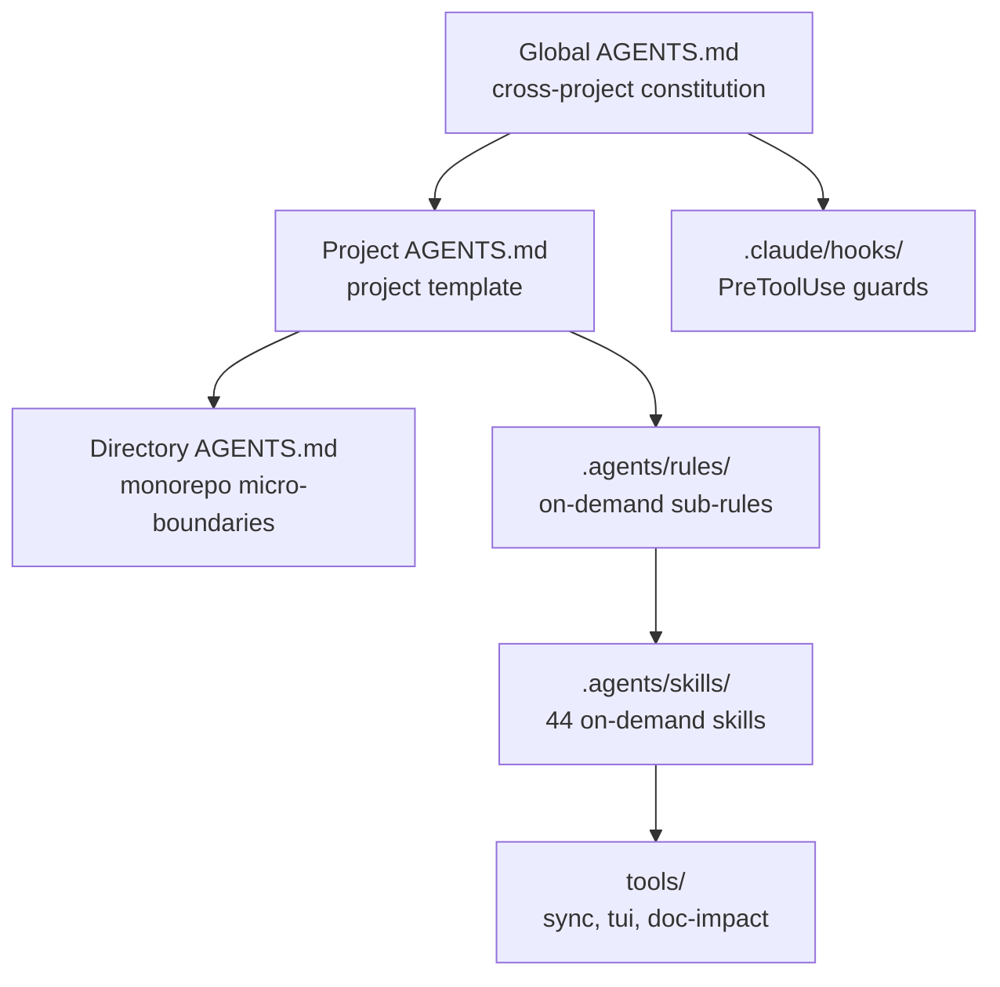

# Agent Harness

> **Language / Sprache**: [English](README.md) | [简体中文](README.zh.md) | [繁體中文](README.zh-tw.md) | [Français](README.fr.md) | **Deutsch**

> **Wiederverwendbare KI-Codierungsrichtlinien, Sicherheits-Hooks für Claude Code und plattformübergreifende Bereitstellungsskripte**

> **⚡ 30-Sekunden-Start**: `git clone https://github.com/xusofty-cyber/agent-harness.git && cd agent-harness && ./pipeline.sh`
> Details siehe [Quick Start](#quick-start). Glossar: [docs/glossary.md](docs/glossary.md).

Dieses Repository bietet globale, projekt- und verzeichnisbezogene Regelsätze, Claude Code PreToolUse Sicherheits-Hooks, Skill-Sammlungen sowie Bereitstellungsskripte für Windows/Linux/macOS. Ladeverhalten und Hook-Funktionalitäten variieren je nach Wirtswerkzeug. Hooks sind clientseitige Schutzmechanismen und stellen keine Betriebssystem- oder serverseitigen Sicherheitsgrenzen dar.

---

## Architektur




## Kernmerkmale

1. **Dreistufige AGENTS.md Progressive Disclosure Architektur**:
   - **Globale Ebene ([`Global AGENTS.de.md`](Global%20AGENTS.de.md))**: Projektübergreifende Engineering-Verfassung, prägnanter Kommunikationsstil, Git-Sicherheitsgrenzen und Sitzungs-Governance.
   - **Projektebene ([`Project AGENTS.de.md`](Project%20AGENTS.de.md))**: Anpassbare Vorlage für CLI-Befehle, Technologie-Stack, Architekturleitplanken und bedarfsgesteuerte Regelmatrix.
   - **Verzeichnisebene ([`Directory AGENTS.de.md`](Directory%20AGENTS.de.md))**: Mikromodul-Patch für Monorepos oder isolierte Submodule (In/Out-Scope, isolierte Abhängigkeiten, schnelle Modultests).
   - **Modulare Teilregeln ([`.agents/rules/`](.agents/rules/))**: Bedarfsgesteuert einsehbare Spezifikationen (`token-discipline.md`, `engineering-spec.md`, `security-boundary.md`, `git-workflow.md`).

2. **Claude Code Sicherheits-Hooks ([`.claude/settings.json`](.claude/settings.json) + [`.claude/hooks/`](.claude/hooks/))**:
   - Werden ausschließlich vor passenden Toolaufrufen in Claude Code ausgeführt;
   - Node.js Guard-Skripte verarbeiten JSON über stdin für zuverlässige Blockaden (`exit 2`);
   - Permanente Blockaden: Direkte Commits auf geschützte Branches (`develop`/`master`/`main`/`release*`/`staging`), `git push --force`, Löschen geschützter Remote-Branches, Rebase auf geschützten Branches.

3. **44 wiederverwendbare Skills ([`.agents/skills/`](.agents/skills/))**:
   - **Comet Integrationsleitfaden**: Einstiegspunkt für Comet-Workflows;
   - **Lebendige Dokumentation & Technische Dokumentationsvorlagen**: `living-documentation` (4-Stufen-Modell, Frontmatter-Traceability, L0/L1/L2 Impact-Prüfungen) und `engineering-docs` (15 zweisprachige Phasen-Gate-Vorlagen für 31 F&E-Dokumenttypen);
   - **Spezifikationsgetriebene Entwicklung (SDD)**: 16 Skills der `openspec`-Suite;
   - **Testgetriebene Entwicklung (TDD)**: 15 Skills der `superpowers`-Suite;
   - **Implementierungs- und Suchunterstützung**: `ponytail` (Entscheidungsleiter für minimale Lösungen) und `codegraph` (Code-Graph MCP);
   - **Ausgabe- und Kommunikationssteuerung**: `rtk` (Token Killer) und `caveman` (komprimierte Ausgabe);
   - **Entscheidungsreview vor Umsetzung**: `option-review` und `cross-tool-memory`;
   - **Professionelle Dokumentenverarbeitung**: `docx`- und `pdf`-Skills;
   - **Skill-Nutzungs- und Trigger-Leitfaden**: Für Trigger-Modi (auto/explizit/hybrid), Kategorisierung und Projektgedächtnis aller 44 Skills siehe [`Skills Usage Guide.de.md`](docs/guides/Skills%20Usage%20Guide.de.md) ([English](docs/guides/Skills%20Usage%20Guide.md) | [简体中文](docs/guides/Skills%20Usage%20Guide.zh.md) | [繁體中文](docs/guides/Skills%20Usage%20Guide.zh-tw.md) | [Français](docs/guides/Skills%20Usage%20Guide.fr.md)).

4. **Ein-Klick-Bereitstellung, interaktiver Assistent & einheitliche Pipeline (`deploy-agents` & `pipeline`)**:
   - **Schrittweiser interaktiver Terminal-Assistent**: Bei Aufruf ohne Argumente (oder mit `--interactive` / `-Interactive`) startet ein geführter TUI-Assistent (Pfeiltasten, Leertaste zur Mehrfachauswahl, Eingabetaste zur Bestätigung) zur Auswahl von Sprache (`en`, `zh`, `zh-tw`, `fr`, `de`), Bereitstellungsumfang (`project`, `global`, `both`), Projektpfad, 12 Agent-Bridge-Dateien (Claude, Copilot, Cursor, Gemini, Windsurf, Cline, Roo, Qwen, Kiro, Continue, Trae, CodeBuddy) sowie optionalen Workflows;
   - **Plattformübergreifender Unified OS Pipeline-Runner** ([`run-pipeline.sh`](run-pipeline.sh) / [`pipeline.sh`](pipeline.sh) & [`run-pipeline.ps1`](run-pipeline.ps1) / [`pipeline.ps1`](pipeline.ps1)): Führt alle 4 Phasen nacheinander aus (Regel- & Bridge-Bereitstellung → ai-memory Gedächtnis → Skill-Synchronisation → Living-Doc-Qualitätsgate), sowohl interaktiv als auch unbeaufsichtigt (`--all -y` / `-All -Yes`);
   - Automatisierte PowerShell- ([`deploy-agents.ps1`](deploy-agents.ps1)) und Bash-Skripte ([`deploy-agents.sh`](deploy-agents.sh)) mit mehrsprachiger Unterstützung (`--lang` / `-Language`);
   - Generierung von `AGENTS.md`, Bridges zu `CLAUDE.md` und GitHub Copilot, sowie Claude Code Hooks;
   - Automatische zeitstempelbasierte Sicherung bei `--global --update`;
   - Erkennung und Installationsangebot für optionale CLI-Werkzeuge (CodeGraph, RTK, Open Code Review, Comet).

5. **Optionales werkzeugübergreifendes Gedächtnis (`ai-memory`)**:
   - Lokaler Ansatz ohne API-Kosten und ohne zwingenden Cloud-LLM-Bedarf;
   - Explizite Aktivierung pro Projekt über `.ai-memory.toml` und Allowlist-Hooks.

### Unterstützungsmatrix

| Werkzeug | Bereitgestellte Konfiguration | Status |
|---|---|---|
| Claude Code | `CLAUDE.md` Bridge, `.claude/skills/` Links, `.claude/settings.json` Hooks | Automatisch eingerichtet; Hooks laufen im Client |
| Antigravity 2.0 / CLI / IDE | Projektregeln/-skills; `--global` schreibt `~/.gemini/AGENTS.md` und `GEMINI.md` Pointer | Unterstützt beide globalen Namen |
| Codex | Global `$CODEX_HOME/AGENTS.md`, Projekt `AGENTS.md` und `.agents/skills/` | `-Global` richtet globale Datei ein; `-Global -Update` sichert und ersetzt |
| ai-memory | Optionale MCP/Hooks für Claude Code, Codex CLI, Antigravity CLI; MCP für IDE | Explizite projektspezifische Aktivierung |
| GitHub Copilot | `.github/copilot-instructions.md` Bridge | Automatisch eingerichtet |
| Zed | `AGENTS.md` Datei | Nur wiederverwendbare Markdown-Dateien |
| Pi / OpenCode | Kein dedizierter Einstiegspunkt | Nicht formell angepasst |

---

## Verzeichnisstruktur

```text
agent-harness/
├── .agents/
│   ├── rules/                       # Modulare Sub-Regeln
│   └── skills/                      # 44 Engineering-Skills
├── .claude/
│   ├── settings.json                # PreToolUse Sicherheitskonfiguration
│   └── hooks/                       # Sicherheits-Hooks
├── Global AGENTS.md                 # Globale Regelvorlage
├── Project AGENTS.md                # Projektstamm-Vorlage & Router
├── Directory AGENTS.md              # Verzeichnisbezogener Patch
├── Multi-Tool Deployment and Configuration Guide.de.md # Bereitstellungsleitfaden (Deutsch)
├── Multi-Tool Deployment and Configuration Guide.md    # Bereitstellungsleitfaden (Englisch)
├── Tools Practical Usage and Skills Panorama Guide.de.md # Praxisleitfaden (Deutsch)
├── Tools Practical Usage and Skills Panorama Guide.md    # Praxisleitfaden (Englisch)
├── Skills Usage Guide.de.md                       # Skills-Nutzungsleitfaden (Deutsch)
├── Skills Usage Guide.md                          # Skills-Nutzungsleitfaden (Englisch)
├── run-pipeline.ps1 / pipeline.ps1  # Windows PowerShell Pipeline-Runner
├── run-pipeline.sh / pipeline.sh   # Linux / macOS Bash Pipeline-Runner
├── deploy-agents.ps1                # Windows PowerShell-Skript
├── deploy-agents.sh                 # Linux / macOS Bash-Skript
├── setup-ai-memory.ps1              # ai-memory Setup (Windows)
├── setup-ai-memory.sh               # ai-memory Setup (Unix)
├── tools/tui.py                     # Terminal-UI-Auswahlbibliothek
├── tools/sync-skills.py             # Synchronisierungs- und Drift-Prüftool
├── tools/doc-impact.py              # Living-Doc-Auswirkungsanalyse und Gate
├── .ai-memory.toml.example          # Beispiel für lokalen Marker
├── skills-lock.json                 # Metadaten zu Quellen und Hashes
├── README.md                        # Übersicht (Englisch)
└── README.zh.md                     # Übersicht (Vereinfachtes Chinesisch)
```

---

## Schnellstart

### 1. Unified Pipeline Ein-Klick-Ausführung (Empfohlen)

Führen Sie alle Phasen der Toolchain nacheinander über den Pipeline-Runner aus:

- **Linux / macOS (Bash)**:
  ```bash
  # Interaktiver Assistent (schrittweise TUI-Auswahl):
  ./pipeline.sh
  # Vollständige Pipeline ohne Benutzereingriff:
  ./pipeline.sh --all -y
  ```

- **Windows (PowerShell)**:
  ```powershell
  # Interaktiver Assistent (schrittweise TUI-Auswahl):
  .\pipeline.ps1
  # Vollständige Pipeline ohne Benutzereingriff:
  .\pipeline.ps1 -All -Yes
  ```

### 2. Eigenständige Bereitstellung & interaktiver Assistent

- **Interaktiver Assistent (Aufruf ohne Argumente)**:
  ```bash
  # Linux / macOS:
  ./deploy-agents.sh
  # Windows:
  .\deploy-agents.ps1
  ```
  *Startet den schrittweisen TUI-Auswahlassistenten für Sprache, Umfang, Projektpfad, Agent-Bridges und Workflows.*

- **Windows Befehlszeile (PowerShell)**:
  ```powershell
  .\deploy-agents.ps1 -ProjectPath "D:\Projects\my-project" -Global -Language de -Initialize -DirectoryPath "packages/core"
  .\deploy-agents.ps1 -ProjectPath "D:\Projects\my-project" -Check -DirectoryPath "packages/core"
  ```

- **Linux / macOS Befehlszeile (Bash)**:
  ```bash
  chmod +x ./deploy-agents.sh
  ./deploy-agents.sh /path/to/my-project --global --lang de --initialize --directory packages/core
  ./deploy-agents.sh /path/to/my-project --check --directory packages/core
  ```

### 3. Optionales Langzeitgedächtnis (ai-memory)

```bash
cargo install ai-memory
cp .ai-memory.toml.example .ai-memory.toml
sed -i 's/replace-with-workspace-name/default/g; s/replace-with-project-name/agent-harness/g' .ai-memory.toml
./setup-ai-memory.sh antigravity-ide
# Option A: Direkte Ausführung
ai-memory serve --transport http

# Option B: Docker-Container (isolierte Umgebung)
# Der Datenpfad im Container ist fest auf /data gesetzt; bindet an 127.0.0.1 für lokale Sicherheit
docker run -d --name ai-memory \
  --restart unless-stopped \
  -p 127.0.0.1:49374:49374 \
  -v "${HOME}/env/ai-memory-data:/data" \
  docker.io/akitaonrails/ai-memory:latest
```

### 4. Online-Aktualisierung

```bash
./deploy-agents.sh . --update
```

---

## Dokumentenindex

- 📖 **Bereitstellung & Konfiguration**:
  - [Deutsch](docs/guides/Multi-Tool%20Deployment%20and%20Configuration%20Guide.de.md) | [English](docs/guides/Multi-Tool%20Deployment%20and%20Configuration%20Guide.md) | [简体中文](docs/guides/Multi-Tool%20Deployment%20and%20Configuration%20Guide.zh.md) | [繁體中文](docs/guides/Multi-Tool%20Deployment%20and%20Configuration%20Guide.zh-tw.md) | [Français](docs/guides/Multi-Tool%20Deployment%20and%20Configuration%20Guide.fr.md)
- 📖 **Praxis & Skill-Panorama**:
  - [Deutsch](docs/guides/Tools%20Practical%20Usage%20and%20Skills%20Panorama%20Guide.de.md) | [English](docs/guides/Tools%20Practical%20Usage%20and%20Skills%20Panorama%20Guide.md) | [简体中文](docs/guides/Tools%20Practical%20Usage%20and%20Skills%20Panorama%20Guide.zh.md) | [繁體中文](docs/guides/Tools%20Practical%20Usage%20and%20Skills%20Panorama%20Guide.zh-tw.md) | [Français](docs/guides/Tools%20Practical%20Usage%20and%20Skills%20Panorama%20Guide.fr.md)
- 📜 **Drei-Stufen-Regelarchitektur**:
  - **Globale Regeln**: [`Global AGENTS.de.md`](Global%20AGENTS.de.md) (Deutsch) | [`English`](Global%20AGENTS.en.md) | [`简体中文`](Global%20AGENTS.md) | [`繁體中文`](Global%20AGENTS.zh-tw.md) | [`Français`](Global%20AGENTS.fr.md)
  - **Projektregeln**: [`Project AGENTS.de.md`](Project%20AGENTS.de.md) (Deutsch) | [`English`](Project%20AGENTS.en.md) | [`简体中文`](Project%20AGENTS.md) | [`繁體中文`](Project%20AGENTS.zh-tw.md) | [`Français`](Project%20AGENTS.fr.md)
  - **Verzeichnisregeln**: [`Directory AGENTS.de.md`](Directory%20AGENTS.de.md) (Deutsch) | [`English`](Directory%20AGENTS.en.md) | [`简体中文`](Directory%20AGENTS.md) | [`繁體中文`](Directory%20AGENTS.zh-tw.md) | [`Français`](Directory%20AGENTS.fr.md)

---

## Lizenz

Dieses Projekt steht unter der MIT-Lizenz. Eingebettete Skills von Drittanbietern unterliegen ihren jeweiligen Originallizenzen.
