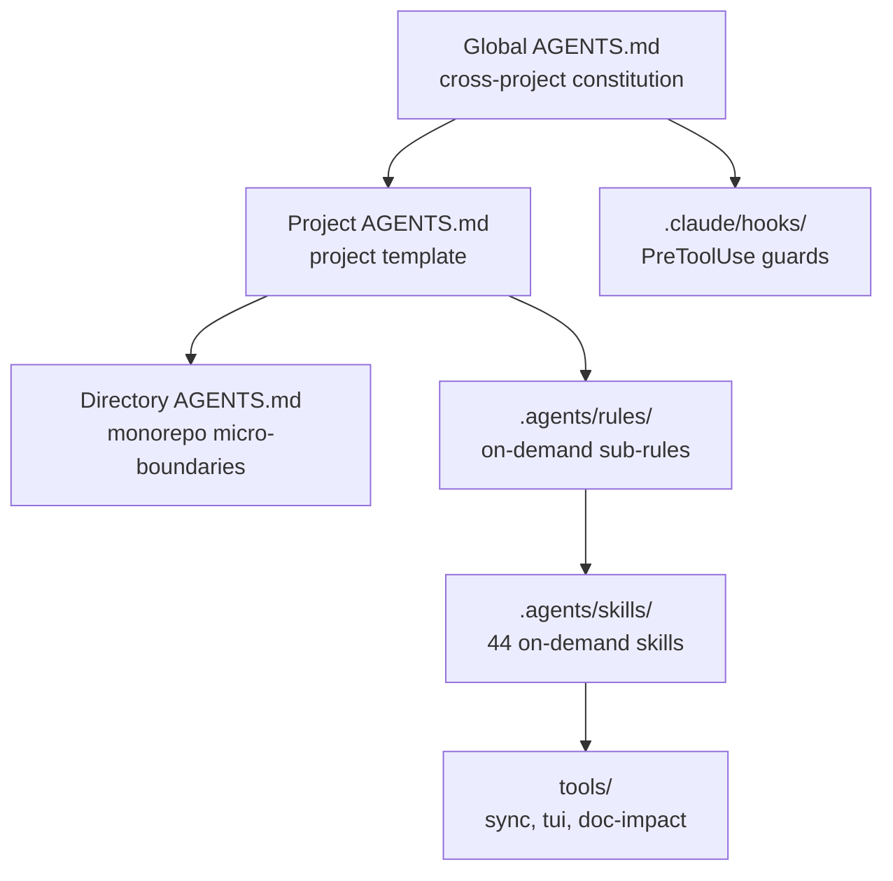

# Agent Harness

> **Language / Langue**: [English](README.md) | [简体中文](README.zh.md) | [繁體中文](README.zh-tw.md) | **Français** | [Deutsch](README.de.md)

> **Modèles réutilisables de règles de programmation IA, crochets de sécurité Claude Code et scripts de déploiement multi-outils**

Ce dépôt fournit des modèles de règles aux niveaux global, projet et répertoire, des crochets PreToolUse pour Claude Code, des bibliothèques de compétences (skills) et des scripts de déploiement pour Windows/Linux/macOS. Le comportement de chargement et les fonctionnalités varient selon l'outil hôte. Les crochets sont des mécanismes côté client et ne constituent pas des barrières de sécurité côté système d'exploitation ou serveur.

## Prérequis

- **Linux/macOS** : `bash`, `git`, `python3` (préinstallés sur la plupart des systèmes)
- **Windows** : PowerShell 5.1+, `git`
- **Optionnel** : `node` (pour les crochets Claude Code), `cargo` (pour ai-memory)

---

## Architecture du système



## Fonctionnalités clés

1. **Architecture progressive à trois niveaux AGENTS.md** :
   - **Niveau global ([`Global AGENTS.fr.md`](templates/agents/Global%20AGENTS.fr.md))** : Constitution d'ingénierie transverse, standard de communication concise, règles d'autorisation Git et gouvernance de session.
   - **Niveau projet ([`Project AGENTS.fr.md`](templates/agents/Project%20AGENTS.fr.md))** : Modèle adaptable pour commandes CLI, stack technique, garde-fous d'architecture et matrice de compétences.
   - **Niveau répertoire ([`Directory AGENTS.fr.md`](templates/agents/Directory%20AGENTS.fr.md))** : Patch micromodule pour sous-paquets de monorepos ou sous-modules isolés (In/Out scope, isolation des dépendances et tests rapides).
   - **Sous-règles modulaires ([`.agents/rules/`](.agents/rules/))** : Règles consultées dynamiquement (`token-discipline.md`, `engineering-spec.md`, `security-boundary.md`, `git-workflow.md`).

2. **Crochets de sécurité Claude Code ([`.claude/settings.json`](.claude/settings.json) + [`.claude/hooks/`](.claude/hooks/))** :
   - Exécutés uniquement lors des appels d'outils correspondants dans Claude Code ;
   - Scripts de garde Node.js traitant les entrées JSON sur stdin pour un blocage strict (`exit 2`) ;
   - Blocages permanents : commit direct sur branche protégée (`develop`/`master`/`main`/`release*`/`staging`), `git push --force`, suppression de branche distante protégée, rebase sur branche protégée.

3. **44 compétences réutilisables ([`.agents/skills/`](.agents/skills/))** :
   - **Guide Comet** : point d'entrée pour les flux Comet ;
   - **Documentation vivante & Modèles de documentation technique** : `living-documentation` (modèle à 4 niveaux, traçabilité bidirectionnelle code-doc, seuils d'impact L0/L1/L2) et `engineering-docs` (15 modèles bilingues de portes de phase couvrant 31 types de documents de R&D) ;
   - **Spec-Driven Development (SDD)** : suite de 16 compétences `openspec` ;
   - **Test-Driven Development (TDD)** : suite de 15 compétences `superpowers` ;
   - **Orientation implémentation** : `ponytail` (échelle de solution minimale) et `codegraph` (graphe de code via MCP) ;
   - **Sortie et communication** : `rtk` (troncature et limitation de tokens) et `caveman` (mode ultra-concis) ;
   - **Revue avant décision & mémoire partagée** : `option-review` et `cross-tool-memory` ;
   - **Documents professionnels** : compétences `docx` et `pdf` ;
   - **Guide d'utilisation et déclenchement des compétences** : Pour les modes de déclenchement (auto/explicite/hybride), la catégorisation et la mémoire de projet de l'ensemble des 44 compétences, voir [`Skills Usage Guide.fr.md`](docs/guides/Skills%20Usage%20Guide.fr.md) ([English](docs/guides/Skills%20Usage%20Guide.md) | [简体中文](docs/guides/Skills%20Usage%20Guide.zh.md) | [繁體中文](docs/guides/Skills%20Usage%20Guide.zh-tw.md) | [Deutsch](docs/guides/Skills%20Usage%20Guide.de.md)).

4. **Déploiement en un clic, assistant interactif & pipeline unifié (`deploy-agents` & `run-pipeline`)** :
   - **Assistant terminal interactif étape par étape** : L'exécution sans argument (ou avec `--interactive` / `-Interactive`) lance un assistant guidé (navigation par flèches, sélection multiple par espace, validation Entrée) pour choisir la langue (`en`, `zh`, `zh-tw`, `fr`, `de`), la portée (`project`, `global`, `both`), le chemin du projet et sélectionner parmi 12 ponts d'outils (Claude, Copilot, Cursor, Gemini, Windsurf, Cline, Roo, Qwen, Kiro, Continue, Trae, CodeBuddy) ainsi que les workflows optionnels ;
   - **Exécuteur de pipeline d'OS unifié** ([`run-pipeline.sh`](run-pipeline.sh) & [`run-pipeline.ps1`](run-pipeline.ps1)) : Orchestre les 4 étapes du cycle de vie en séquence (Déploiement des règles et ponts → Mémoire IA partagée → Synchronisation des compétences → Porte de qualité living-doc), avec mode interactif ou sans surveillance (`--all -y` / `-All -Yes`) ;
   - Scripts automatisés pour PowerShell ([`deploy-agents.ps1`](deploy-agents.ps1)) et Bash ([`deploy-agents.sh`](deploy-agents.sh)) avec support multilingue (`--lang` / `-Language`) ;
   - Génération de `AGENTS.md`, ponts vers `CLAUDE.md` et Copilot, et crochets Claude Code ;
   - Sauvegarde préalable avec horodatage lors de `--global --update` ;
   - Détection et invite d'installation pour les CLI optionnels (CodeGraph, RTK, Open Code Review, Comet).

5. **Mémoire partagée inter-outils optionnelle (`ai-memory`)** :
   - Approche locale sans frais d'API, sans LLM obligatoire ;
   - Activation explicite via `.ai-memory.toml` et crochets amont en mode liste blanche.

### Périmètre de prise en charge

| Outil | Configuration fournie | Statut |
|---|---|---|
| Claude Code | Pont `CLAUDE.md`, liens `.claude/skills/`, crochets `.claude/settings.json` | Configuré par script ; crochets actifs côté client |
| Antigravity 2.0 / CLI / IDE | Règles/compétences du projet ; `--global` écrit `~/.gemini/AGENTS.md` et le pointeur `GEMINI.md` | Prise en charge des deux noms globaux |
| Codex | Global `$CODEX_HOME/AGENTS.md`, `AGENTS.md` du projet et `.agents/skills/` | `-Global` initialise le fichier global ; `-Global -Update` sauvegarde et remplace |
| ai-memory | MCP/crochets optionnels pour Claude Code, Codex CLI, Antigravity CLI ; MCP seul pour IDE | Activation explicite par projet |
| GitHub Copilot | Pont `.github/copilot-instructions.md` | Configuré par script |
| Zed | Fichier `AGENTS.md` | Fichiers réutilisables uniquement |
| Pi / OpenCode | Aucun point d'entrée spécifique | Non adapté formellement |

---

## Structure du répertoire

```text
agent-harness/
├── .agents/
│   ├── rules/                       # Sous-règles d'ingénierie modulaires
│   └── skills/                      # 44 compétences d'ingénierie
├── .claude/
│   ├── settings.json                # Configuration PreToolUse Claude Code
│   └── hooks/                       # Scripts de garde et interception
├── templates/
│   └── agents/                      # Modèles de règles canoniques (Global/Project/Directory x 5 langues)
├── run-pipeline.ps1                 # Exécuteur de pipeline unifié Windows PowerShell
├── run-pipeline.sh                  # Exécuteur de pipeline unifié Linux / macOS Bash
├── deploy-agents.ps1                # Script Windows PowerShell
├── deploy-agents.sh                 # Script Linux / macOS Bash
├── setup-ai-memory.ps1              # Script de configuration ai-memory (Windows)
├── setup-ai-memory.sh               # Script de configuration ai-memory (Unix)
├── tools/tui.py                     # Bibliothèque TUI de sélection en ligne de commande
├── tools/sync-skills.py             # Outil de synchronisation des compétences externes
├── tools/doc-impact.py              # Analyse d'impact et porte de qualité living-doc
├── .ai-memory.toml.example          # Exemple de marqueur d'activation locale
├── skills-lock.json                 # Métadonnées d'intégrité et sources
├── README.md                        # Présentation (English)
└── README.zh.md                     # Présentation (Chinois simplifié)
```

---

## Démarrage rapide

### 1. Exécution du pipeline unifié en un clic (Recommandé)

Exécutez toutes les étapes du cycle de vie de manière séquentielle via le pipeline unifié :

- **Linux / macOS (Bash)** :
  ```bash
  # Mode interactif (assistant guidé par étapes) :
  ./run-pipeline.sh
  # Exécution complète sans surveillance :
  ./run-pipeline.sh --all -y
  ```

- **Windows (PowerShell)** :
  ```powershell
  # Mode interactif (assistant guidé par étapes) :
  .\run-pipeline.ps1
  # Exécution complète sans surveillance :
  .\run-pipeline.ps1 -All -Yes
  ```

### 2. Déploiement autonome & assistant interactif

- **Assistant interactif (Lancement sans argument)** :
  ```bash
  # Linux / macOS :
  ./deploy-agents.sh
  # Windows :
  .\deploy-agents.ps1
  ```
  *Lance l'assistant pas à pas : choix de langue, portée, chemin cible, ponts d'outils et workflows optionnels.*

- **Ligne de commande Windows (PowerShell)** :
  ```powershell
  .\deploy-agents.ps1 -ProjectPath "D:\Projects\my-project" -Global -Language fr -Initialize -DirectoryPath "packages/core"
  .\deploy-agents.ps1 -ProjectPath "D:\Projects\my-project" -Check -DirectoryPath "packages/core"
  ```

- **Ligne de commande Linux / macOS (Bash)** :
  ```bash
  chmod +x ./deploy-agents.sh
  ./deploy-agents.sh /path/to/my-project --global --lang fr --initialize --directory packages/core
  ./deploy-agents.sh /path/to/my-project --check --directory packages/core
  ```

### 3. Mémoire partagée optionnelle (ai-memory)

#### Étape 1 : Installer le CLI prérequis et préparer l'environnement
- **Via Rust Cargo** :
  ```bash
  cargo install ai-memory
  ```
- **Ou via GitHub Releases (binaire précompilé)** :
  - **Linux / macOS** :
    ```bash
    mkdir -p ~/.local/bin
    curl -fsSL https://github.com/akitaonrails/ai-memory/releases/latest/download/ai-memory-linux-x86_64.tar.gz | tar -xz -C ~/.local/bin/
    chmod +x ~/.local/bin/ai-memory
    export PATH="$HOME/.local/bin:$PATH"
    ```
  - **Windows** :
    Téléchargez l'archive depuis [Releases](https://github.com/akitaonrails/ai-memory/releases) (`ai-memory-windows-x86_64.zip`), extrayez-la et ajoutez son répertoire à votre `PATH` système.
- 💡 **Dépannage : Actualisation du PATH dans Windows Terminal**
  Si vous avez modifié `PATH` pendant qu'Antigravity IDE / VS Code était en cours d'exécution, les sessions de terminal actives n'hériteront pas du changement. Dans PowerShell, actualisez PATH directement depuis le registre sans redémarrer l'IDE :
  ```powershell
  $env:Path = [System.Environment]::GetEnvironmentVariable("Path","Machine") + ";" + [System.Environment]::GetEnvironmentVariable("Path","User")
  ```

#### Étape 2 : Initialiser le marqueur d'adhésion du projet (.ai-memory.toml)
ai-memory applique une politique stricte de refus par défaut, exigeant un marqueur d'adhésion explicite avant de capturer tout dépôt (ce fichier est ignoré par `.gitignore` et ne sera donc jamais commité par accident) :
- **Windows PowerShell** :
  ```powershell
  Copy-Item .ai-memory.toml.example .ai-memory.toml
  (Get-Content .ai-memory.toml) `
      -replace 'replace-with-workspace-name', 'default' `
      -replace 'replace-with-project-name', 'agent-harness' |
      Set-Content .ai-memory.toml
  ```
- **Linux / macOS (Bash)** :
  ```bash
  cp .ai-memory.toml.example .ai-memory.toml
  sed -i 's/replace-with-workspace-name/default/g; s/replace-with-project-name/agent-harness/g' .ai-memory.toml
  ```

#### Étape 3 : Exécuter l'assistant de configuration client
Exécutez le script de configuration pour enregistrer le point de terminaison MCP et les instructions de skill gérées (prend en charge `antigravity-ide`, `antigravity-cli`, `claude-code`, `codex`) :
- **Windows** :
  ```powershell
  .\setup-ai-memory.ps1 -Agent antigravity-ide
  ```
- **Linux / macOS** :
  ```bash
  chmod +x ./setup-ai-memory.sh
  ./setup-ai-memory.sh antigravity-ide
  ```
- 🔍 **Guide de sortie** :
  - `✓ no-op ... (already up to date)` : Indique une **protection d'idempotence** ; les fichiers cibles existants sont déjà à jour et ne nécessitent pas de réécriture.
  - `Configured <agent>. No server, container, API key, or LLM provider was installed or started.` : Confirmation déclarative que la configuration client est terminée, honorant la garantie zéro-démon / zéro-facturation.

#### Étape 4 : Démarrer le moteur de mémoire local
- **Pour Antigravity IDE (via HTTP MCP)** :
  > ⚠️ `ai-memory serve` utilise par défaut le mode de transport `stdio`, qui ne lie aucun port réseau. Pour servir Antigravity IDE, **vous devez le démarrer avec `--transport http`** :
  - **Terminal au premier plan** :
    ```bash
    ai-memory serve --transport http
    ```
    Une fois que le terminal affiche `bind=127.0.0.1:49374`, le serveur est prêt et l'IDE peut interroger et stocker la mémoire du projet via MCP.
  - **Démon d'arrière-plan Linux (nohup / systemd)** :
    Utilisez `nohup ai-memory serve --transport http > ~/.local/share/ai-memory/serve.log 2>&1 &` ou créez un service utilisateur avec `systemd --user`.
  - **Conteneur Docker** :
    ```bash
    # Le chemin des données dans le conteneur est fixé à /data ; lie à 127.0.0.1 pour la sécurité locale
    docker run -d --name ai-memory \
      --restart unless-stopped \
      -p 127.0.0.1:49374:49374 \
      -v "${HOME}/env/ai-memory-data:/data" \
      docker.io/akitaonrails/ai-memory:latest
    ```
- **Pour Claude Code / Codex CLI** :
  Les hooks natifs du cycle de vie capturent automatiquement les sessions, ou utilisez `ai-memory run <harness>` pour un lancement de flux de travail géré.

### 4. Mise à jour en ligne

```bash
./deploy-agents.sh . --update
```

---

## Index documentaire

- 📖 **Déploiement & Configuration** :
  - [Français](docs/guides/Multi-Tool%20Deployment%20and%20Configuration%20Guide.fr.md) | [English](docs/guides/Multi-Tool%20Deployment%20and%20Configuration%20Guide.md) | [简体中文](docs/guides/Multi-Tool%20Deployment%20and%20Configuration%20Guide.zh.md) | [繁體中文](docs/guides/Multi-Tool%20Deployment%20and%20Configuration%20Guide.zh-tw.md) | [Deutsch](docs/guides/Multi-Tool%20Deployment%20and%20Configuration%20Guide.de.md)
- 📖 **Usage pratique & Panorama des compétences** :
  - [Français](docs/guides/Tools%20Practical%20Usage%20and%20Skills%20Panorama%20Guide.fr.md) | [English](docs/guides/Tools%20Practical%20Usage%20and%20Skills%20Panorama%20Guide.md) | [简体中文](docs/guides/Tools%20Practical%20Usage%20and%20Skills%20Panorama%20Guide.zh.md) | [繁體中文](docs/guides/Tools%20Practical%20Usage%20and%20Skills%20Panorama%20Guide.zh-tw.md) | [Deutsch](docs/guides/Tools%20Practical%20Usage%20and%20Skills%20Panorama%20Guide.de.md)
- 📜 **Architecture des règles à trois niveaux** :
  - **Règles globales** : [`Global AGENTS.fr.md`](templates/agents/Global%20AGENTS.fr.md) (Français) | [`English`](templates/agents/Global%20AGENTS.en.md) | [`简体中文`](templates/agents/Global%20AGENTS.md) | [`繁體中文`](templates/agents/Global%20AGENTS.zh-tw.md) | [`Deutsch`](templates/agents/Global%20AGENTS.de.md)
  - **Règles de projet** : [`Project AGENTS.fr.md`](templates/agents/Project%20AGENTS.fr.md) (Français) | [`English`](templates/agents/Project%20AGENTS.en.md) | [`简体中文`](templates/agents/Project%20AGENTS.md) | [`繁體中文`](templates/agents/Project%20AGENTS.zh-tw.md) | [`Deutsch`](templates/agents/Project%20AGENTS.de.md)
  - **Règles de répertoire** : [`Directory AGENTS.fr.md`](templates/agents/Directory%20AGENTS.fr.md) (Français) | [`English`](templates/agents/Directory%20AGENTS.en.md) | [`简体中文`](templates/agents/Directory%20AGENTS.md) | [`繁體中文`](templates/agents/Directory%20AGENTS.zh-tw.md) | [`Deutsch`](templates/agents/Directory%20AGENTS.de.md)

---

## Licence

Ce projet est distribué sous licence MIT. Les compétences tierces intégrées conservent leurs licences d'origine respectives.
