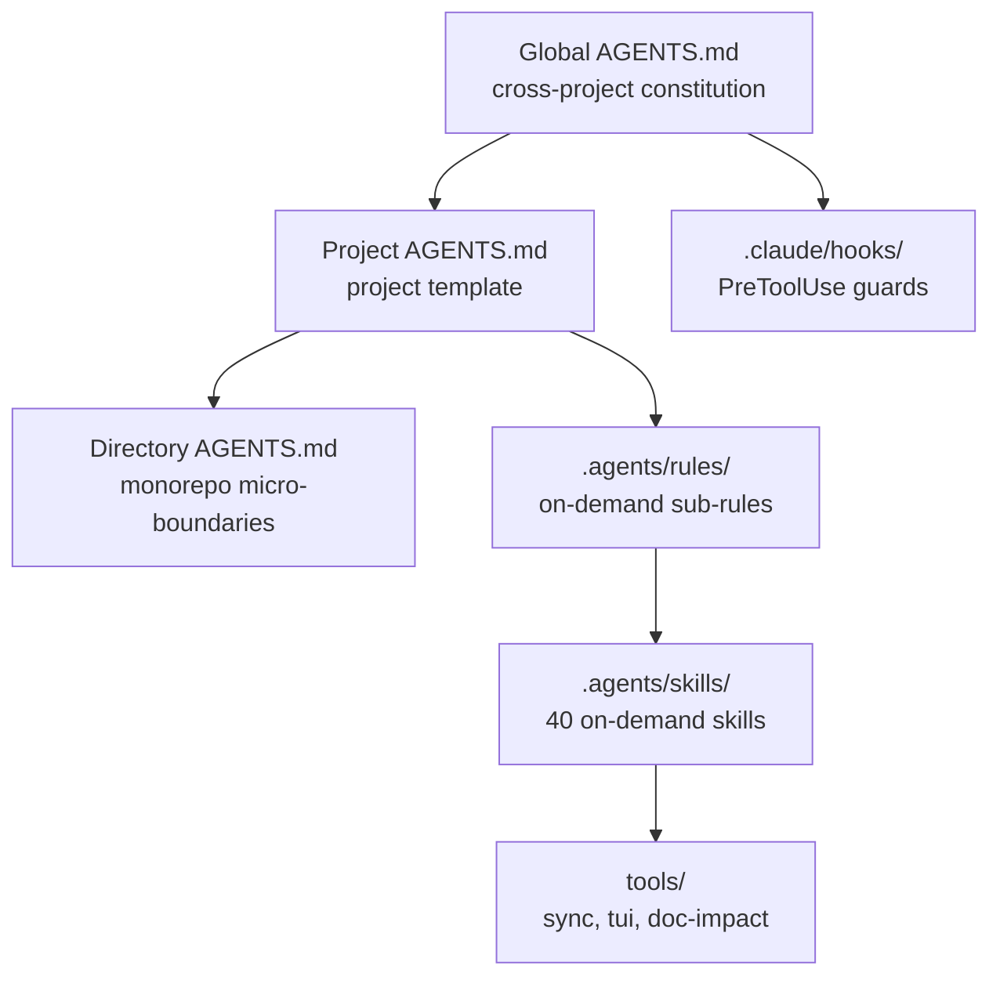

# Agent Harness

> **Language / 语言**: **English** | [简体中文](README.zh.md) | [繁體中文](README.zh-tw.md) | [Français](README.fr.md) | [Deutsch](README.de.md)

> **Reusable AI coding-rule templates, Claude Code hooks, and multi-tool deployment scripts**

> **⚡ 30-second start**: `git clone https://github.com/xusofty-cyber/agent-harness.git && cd agent-harness && ./run-pipeline.sh --all -y`
> See [Quick Start](#quick-start) for details. New to the jargon? Check [Glossary](docs/glossary.md).

This repository provides global, project, and directory rule templates, Claude Code PreToolUse hooks, skill files, and Windows/Linux/macOS deployment scripts. Rule loading and hook behavior vary by tool. Hooks are client-side mechanisms, not operating-system or server-side security boundaries.

> **Positioning**: this repository is a config + skill distribution pack with a minimal gate scaffold (from Phase 1). It contains no agent runtime: the core gate is self-owned and host-agnostic, and Comet is an optional adapter, not the harness itself.

## Prerequisites

- **Linux/macOS**: `bash`, `git`, `python3` (pre-installed on most systems)
- **Windows**: PowerShell 5.1+, `git`
- **Optional**: `node` (for Claude Code hooks), `cargo` (for ai-memory)

---

## Architecture



## Key Features

1. **Three-Tier AGENTS.md Progressive Disclosure Architecture**:
   - **Global Level ([`Global AGENTS.md`](templates/agents/Global%20AGENTS.md))**: Cross-project engineering constitution covering the no-nonsense communication gate, minimal-implementation guidance, Git authorization rules, and contextual workflow guidance.
   - **Project Level ([`Project AGENTS.md`](templates/agents/Project%20AGENTS.md))**: Adaptable project template for CLI commands, tech stack, architecture boundaries, and on-demand rule references.
   - **Directory Level ([`Directory AGENTS.md`](templates/agents/Directory%20AGENTS.md))**: Micro-boundary patch for Monorepo packages or isolated submodules (In/Out Scope, dependency boundaries, targeted fast tests, and large-file safety).
   - **Modular Sub-Rules ([`.agents/rules/`](.agents/rules/))**: On-demand progressive rules including `token-discipline.md`, `engineering-spec.md`, `security-boundary.md`, and `git-workflow.md`.

2. **Claude Code client hooks ([`.claude/settings.json`](.claude/settings.json) + [`.claude/hooks/`](.claude/hooks/))**:
   - Run only for matching tool calls in Claude Code; they are not OS-level protections;
   - Some command patterns are hard-blocked while other cases emit non-blocking warnings;
   - Regex inspection cannot cover every command form and does not replace server-side branch protection.

3. **40 Reusable Skill Directories ([`.agents/skills/`](.agents/skills/))**:
   - **Comet integration guide**: checks the installed version and project configuration; this skill does not implement Comet's state machine or phase guards;
   - **Living Documentation & Engineering Docs**: `living-documentation` (4-tier doc model: specs/architecture/reference/guides, frontmatter-based code-doc bidirectional traceability, L0/L1/L2 impact maintenance) and `engineering-docs` (15 bilingual phase-gate templates covering 31 R&D document types for cross-agent consistency);
   - **Spec-Driven Development (SDD)**: Full 12-skill `openspec` suite (proposal, apply changes, verify, sync specs, archive, explore);
   - **Test-Driven Development (TDD)**: Full 15-skill `superpowers` suite (red-green cycle, systematic root-cause debugging, physical verification evidence gate, git worktrees);
   - **Implementation and retrieval guidance**: `ponytail` (minimal-solution ladder) and `codegraph` (optional CodeGraph integration guide; CLI/MCP setup is separate);
   - **Output and communication guidance**: `rtk` (optional Rust Token Killer CLI guide; command-rewrite hooks require setup) and `caveman` (concise-response Skill);
   - **Pre-decision review and shared memory**: `option-review` (isolated 5-dimension candidate approach review matrix) and `cross-tool-memory` (project-scoped long-term memory navigation aid);
   - **Professional Document Processing**: `docx` (Word formatting & manipulation) and `pdf` (structured extraction & analysis). Note: `docx` ships its full OOXML validation toolchain (~1.3 MB, mostly XSD schemas), making it the largest skill in the repo — delete the directory from your target project if you never process Word files;
   - **Skills Usage & Trigger Guide**: For trigger modes (auto/explicit/hybrid), categorization, and project memory setup of all 40 skills, see [`Skills Usage Guide.md`](docs/guides/Skills%20Usage%20Guide.md) ([简体中文](docs/guides/Skills%20Usage%20Guide.zh.md) | [繁體中文](docs/guides/Skills%20Usage%20Guide.zh-tw.md) | [Français](docs/guides/Skills%20Usage%20Guide.fr.md) | [Deutsch](docs/guides/Skills%20Usage%20Guide.de.md)).

4. **One-Click Deployment, Interactive Wizard & Unified Pipeline (`deploy-agents` & `run-pipeline`)**:
   - **Interactive Step-by-Step Terminal Wizard**: Running scripts without arguments (or with `--interactive` / `-Interactive`) launches a guided TUI wizard (arrow keys to move, spacebar to toggle, enter to confirm) to select template language (`en`, `zh`, `zh-tw`, `fr`, `de`), deployment scope (`project`, `global`, `both`), target project path, and multi-select agent bridge files (Claude, Copilot, Cursor, Gemini, Windsurf, Cline, Roo, Qwen, Kiro, Continue, Trae, CodeBuddy) plus optional workflows, preventing CLI mistakes;
   - **Unified OS Pipeline Runner** ([`run-pipeline.sh`](run-pipeline.sh) & [`run-pipeline.ps1`](run-pipeline.ps1)): Orchestrates the entire agent lifecycle in 4 sequential stages (Deploy rules & bridges → Setup AI memory → Sync external skills → Living documentation impact gate) with both interactive wizard and unattended (`--all -y` / `-All -Yes`) modes;
   - PowerShell automation ([`deploy-agents.ps1`](deploy-agents.ps1)) with automatic Directory Junctions for non-admin permission penetration and Bash automation ([`deploy-agents.sh`](deploy-agents.sh));
   - The project script creates `AGENTS.md` when absent, Claude Code and Copilot bridges, and Claude Code hooks; see the support matrix for the actual scope;
   - `--global` configures Claude Code, Antigravity, and Codex global rule files; `--global --update` backs up replaced files;
   - `--update` fast-forwards this template repository and syncs files. It backs up managed target rules/skills before replacement. `skills-lock.json` is source/integrity metadata; the script does not download skills by locked hashes. Ponytail and Caveman are copied as Skill files. CodeGraph and RTK setup is optional; the deployment scripts offer interactive prompts for installation, agent wiring, and project initialization.
   - After project deployment, the scripts detect optional CodeGraph/RTK CLIs and ask separately before installation and agent/project configuration. The default is No. Non-interactive runs skip installation and print follow-up commands.

5. **Optional cross-tool project memory (`ai-memory`)**:
   - The selected backend is local-first and can run with no LLM, embedding provider, or API key; it is not installed or started by the normal deployment scripts;
   - Capture is project opt-in through an ignored local `.ai-memory.toml` and upstream hooks installed in allowlist mode;
   - Dedicated setup helpers configure Claude Code, Codex, and Antigravity CLI through the upstream merge-aware CLI; Antigravity 2.0 and IDE receive MCP-only setup through the same global config. ChatGPT web uses a human-mediated Markdown handoff in the free local setup.

### Support scope

| Tool | Configuration provided here | Enforcement | Status |
|---|---|---|---|
| Claude Code | `CLAUDE.md` bridge, `.claude/skills/` links, `.claude/settings.json` hooks | Enforced (hooks) | Configured by script; hooks run only in the Claude Code client |
| Antigravity 2.0 / CLI / IDE & extensions | Project rules/skills; `--global` writes `~/.gemini/AGENTS.md` plus a `GEMINI.md` compatibility pointer | Config only | Current surfaces load both global names; older IDE releases can follow the pointer. CLI-only rules remain separate |
| Codex | Global `$CODEX_HOME/AGENTS.md` (default `~/.codex/AGENTS.md`), project `AGENTS.md`, and `.agents/skills/` | Config only | `-Global` initializes the Codex global file; `-Global -Update` backs up and replaces the active global instructions |
| ai-memory | Optional MCP/hooks for Claude Code, Codex CLI, and Antigravity CLI; MCP-only setup for Antigravity 2.0 and IDE | Config only | Explicit per-project opt-in; Codex desktop must be checked against its installed version; ChatGPT web uses manual handoff |
| GitHub Copilot | `.github/copilot-instructions.md` bridge | Config only | Configured by script; behavior depends on Copilot version/mode |
| Zed | `AGENTS.md` | Files only | Reusable files only; no Zed-specific setup by script |
| Pi / OpenCode | No dedicated entry point or script validation | Files only | Not adapted; automatic loading is not implied |

Use `-Initialize` / `--initialize` during deployment to create guidance with locally verifiable project facts and a checklist for unknowns. Add `-DirectoryPath` / `--directory` with an existing module path to generate its directory-level guidance too. The scripts only infer facts supported by local Git metadata, manifests, lockfiles, and CI files. For `package.json`, detected scripts and common framework/storage dependencies are marked as suggestions for review, not verified facts. Users or the active coding agent must confirm purpose, ownership, module responsibility, and boundaries. Existing `AGENTS.md` files are preserved; a review copy is written as `AGENTS.generated.md`. Run `-Check` / `--check` to find unresolved items.

---

## Directory Structure

```text
agent-harness/
├── .agents/
│   ├── rules/                       # Modular sub-rules (loaded on-demand)
│   │   ├── engineering-spec.md      # SDD specification-first, TDD verification gate
│   │   ├── git-workflow.md          # Git authorization model, protected branch isolation
│   │   ├── security-boundary.md     # 8 High-risk operations protection matrix
│   │   └── token-discipline.md      # Read/fetch/speak gates, log truncation
│   └── skills/                      # 40 Native engineering skills (Comet, OpenSpec, Superpowers...)
├── .claude/
│   ├── settings.json                # Claude Code PreToolUse security interceptor config
│   └── hooks/                       # Security hook scripts (Node.js, reads stdin JSON)
│       ├── guard.mjs                # Bash tool guard (exit 2 for hard blocks)
│       └── guard-write.mjs          # Write/Edit tool guard (warnings)
├── templates/
│   └── agents/                      # 15 Canonical rule templates (Global/Project/Directory x 5 langs)
├── run-pipeline.ps1                 # Windows PowerShell unified pipeline runner
├── run-pipeline.sh                  # Linux / macOS Bash unified pipeline runner
├── deploy-agents.ps1                # Windows PowerShell one-click deploy & update script
├── deploy-agents.sh                 # Linux / macOS Bash one-click deploy & update script
├── setup-ai-memory.ps1              # Explicit ai-memory setup for one opted-in project/client
├── setup-ai-memory.sh               # Linux / macOS / WSL setup helper
├── tools/tui.py                     # Terminal UI single/multi select library
├── tools/sync-skills.py             # External skill synchronization & upstream update checker
├── tools/doc-impact.py              # Living documentation impact analysis & quality gate
├── .ai-memory.toml.example          # Safe-to-copy local opt-in marker example
├── skills-lock.json                 # Skill source and partial integrity metadata
├── README.md                        # Repository overview (English default)
└── README.zh.md                     # 项目中文概览
```

---

## Quick Start

### 1. Unified Pipeline One-Click Execution (Recommended)

Run all lifecycle stages in sequence via the unified OS pipeline runner (Deploy rules & bridges → Setup AI memory → Sync external skills → Living documentation impact check):

- **Linux / macOS (Bash)**:
  ```bash
  # Interactive wizard (step-by-step TUI selection):
  ./run-pipeline.sh
  # Unattended full pipeline:
  ./run-pipeline.sh --all -y
  ```

- **Windows (PowerShell)**:
  ```powershell
  # Interactive wizard (step-by-step TUI selection):
  .\run-pipeline.ps1
  # Unattended full pipeline:
  .\run-pipeline.ps1 -All -Yes
  ```

### 2. Standalone Deployment & Interactive Wizard

- **Interactive Wizard (Zero-argument execution)**:
  ```bash
  # Linux / macOS:
  ./deploy-agents.sh
  # Windows:
  .\deploy-agents.ps1
  ```
  *Launches the step-by-step TUI wizard: single-select language, single-select scope, enter path, multi-select agent bridges and optional workflows.*

- **Windows CLI (PowerShell)**:
  ```powershell
  # Deploy to target project (English default, or choose -Language zh / zh-tw / fr / de)
  .\deploy-agents.ps1 -ProjectPath "D:\Projects\my-project" -Global -Language en -Initialize -DirectoryPath "packages/core"
  .\deploy-agents.ps1 -ProjectPath "D:\Projects\my-project" -Check -DirectoryPath "packages/core"
  ```

- **Linux / macOS CLI (Bash)**:
  ```bash
  chmod +x ./deploy-agents.sh
  # Deploy with language selection (English default, or --lang zh / zh-tw / fr / de)
  ./deploy-agents.sh /path/to/my-project --global --lang en --initialize --directory packages/core
  ./deploy-agents.sh /path/to/my-project --check --directory packages/core
  ```

### 3. Optional: Enable Local Cross-Tool Memory (ai-memory)

This repository supports seamless sharing of architectural decisions and session context across multiple agents using [ai-memory](https://github.com/akitaonrails/ai-memory) (local-first, zero API keys, zero embedding cost). Detailed deployment workflow:

#### Step 1: Install prerequisite CLI and prepare environment
- **Via Rust Cargo**:
  ```bash
  cargo install ai-memory
  ```
- **Or via GitHub Releases (pre-built binary)**:
  - **Linux / macOS**:
    ```bash
    mkdir -p ~/.local/bin
    curl -fsSL https://github.com/akitaonrails/ai-memory/releases/latest/download/ai-memory-linux-x86_64.tar.gz | tar -xz -C ~/.local/bin/
    chmod +x ~/.local/bin/ai-memory
    export PATH="$HOME/.local/bin:$PATH"
    ```
  - **Windows**:
    Download the release archive from [Releases](https://github.com/akitaonrails/ai-memory/releases) (`ai-memory-windows-x86_64.zip`), extract it, and add its directory to your system `PATH`.
- 💡 **Troubleshooting: Windows Terminal PATH Refresh**
  If you modified `PATH` while Antigravity IDE / VS Code was running, active terminal sessions will not inherit the change. In PowerShell, refresh PATH directly from the registry without restarting the IDE:
  ```powershell
  $env:Path = [System.Environment]::GetEnvironmentVariable("Path","Machine") + ";" + [System.Environment]::GetEnvironmentVariable("Path","User")
  ```

#### Step 2: Initialize local project opt-in marker (.ai-memory.toml)
ai-memory enforces a safe, fail-closed policy requiring an explicit opt-in marker before capturing any repository (this file is ignored by `.gitignore` so it will never be accidentally committed):
- **Windows PowerShell**:
  ```powershell
  Copy-Item .ai-memory.toml.example .ai-memory.toml
  (Get-Content .ai-memory.toml) `
      -replace 'replace-with-workspace-name', 'default' `
      -replace 'replace-with-project-name', 'agent-harness' |
      Set-Content .ai-memory.toml
  ```
- **Linux / macOS (Bash)**:
  ```bash
  cp .ai-memory.toml.example .ai-memory.toml
  sed -i 's/replace-with-workspace-name/default/g; s/replace-with-project-name/agent-harness/g' .ai-memory.toml
  ```

#### Step 3: Run the client setup helper
Execute the setup script to register the MCP endpoint and managed skill instructions (supports `antigravity-ide`, `antigravity-cli`, `claude-code`, `codex`):
- **Windows**:
  ```powershell
  .\setup-ai-memory.ps1 -Agent antigravity-ide
  ```
- **Linux / macOS**:
  ```bash
  chmod +x ./setup-ai-memory.sh
  ./setup-ai-memory.sh antigravity-ide
  ```
- 🔍 **Output Guide**:
  - `✓ no-op ... (already up to date)`: Indicates **idempotency protection**; existing target files are already up-to-date and require no re-writing.
  - `Configured <agent>. No server, container, API key, or LLM provider was installed or started.`: Declarative confirmation that client configuration is complete, honoring the zero-daemon / zero-billing guarantee.

#### Step 4: Start the local memory engine
- **For Antigravity IDE (via HTTP MCP)**:
  > ⚠️ `ai-memory serve` defaults to `stdio` transport mode, which does not bind a network port. To serve Antigravity IDE, **you must start it with `--transport http`**:
  - **Terminal foreground**:
    ```bash
    ai-memory serve --transport http
    ```
    Once the terminal prints `bind=127.0.0.1:49374`, the server is ready and the IDE can query and store project memory over MCP.
  - **Linux background daemon (nohup / systemd)**:
    Use `nohup ai-memory serve --transport http > ~/.local/share/ai-memory/serve.log 2>&1 &` or create a user-level service with `systemd --user`.
  - **Docker Container**:
    ```bash
    # In-container data path is fixed to /data; binds to 127.0.0.1 for local security
    docker run -d --name ai-memory \
      --restart unless-stopped \
      -p 127.0.0.1:49374:49374 \
      -v "${HOME}/env/ai-memory-data:/data" \
      docker.io/akitaonrails/ai-memory:latest
    ```
- **For Claude Code / Codex CLI**:
  Native lifecycle hooks capture sessions automatically, or use `ai-memory run <harness>` for a managed workstream launch.

### 4. Perform Online Updates

When upstream rules or skills are updated, run directly in the repository:
```powershell
# Windows
.\deploy-agents.ps1 -ProjectPath "." -Update

# Linux / macOS
./deploy-agents.sh . --update
```

---

## Documentation Index

- 📖 **Deployment & Configuration**:
  - [English](docs/guides/Multi-Tool%20Deployment%20and%20Configuration%20Guide.md) | [简体中文](docs/guides/Multi-Tool%20Deployment%20and%20Configuration%20Guide.zh.md) | [繁體中文](docs/guides/Multi-Tool%20Deployment%20and%20Configuration%20Guide.zh-tw.md) | [Français](docs/guides/Multi-Tool%20Deployment%20and%20Configuration%20Guide.fr.md) | [Deutsch](docs/guides/Multi-Tool%20Deployment%20and%20Configuration%20Guide.de.md)
- 📖 **Practical Usage & Skills Panorama**:
  - [English](docs/guides/Tools%20Practical%20Usage%20and%20Skills%20Panorama%20Guide.md) | [简体中文](docs/guides/Tools%20Practical%20Usage%20and%20Skills%20Panorama%20Guide.zh.md) | [繁體中文](docs/guides/Tools%20Practical%20Usage%20and%20Skills%20Panorama%20Guide.zh-tw.md) | [Français](docs/guides/Tools%20Practical%20Usage%20and%20Skills%20Panorama%20Guide.fr.md) | [Deutsch](docs/guides/Tools%20Practical%20Usage%20and%20Skills%20Panorama%20Guide.de.md)
- 📜 **Three-Tier Rules Architecture**:
  - **Global Rules**: [`Global AGENTS.en.md`](templates/agents/Global%20AGENTS.en.md) (EN) | [`简体中文`](templates/agents/Global%20AGENTS.md) | [`繁體中文`](templates/agents/Global%20AGENTS.zh-tw.md) | [`Français`](templates/agents/Global%20AGENTS.fr.md) | [`Deutsch`](templates/agents/Global%20AGENTS.de.md)
  - **Project Rules**: [`Project AGENTS.en.md`](templates/agents/Project%20AGENTS.en.md) (EN) | [`简体中文`](templates/agents/Project%20AGENTS.md) | [`繁體中文`](templates/agents/Project%20AGENTS.zh-tw.md) | [`Français`](templates/agents/Project%20AGENTS.fr.md) | [`Deutsch`](templates/agents/Project%20AGENTS.de.md)
  - **Directory Rules**: [`Directory AGENTS.en.md`](templates/agents/Directory%20AGENTS.en.md) (EN) | [`简体中文`](templates/agents/Directory%20AGENTS.md) | [`繁體中文`](templates/agents/Directory%20AGENTS.zh-tw.md) | [`Français`](templates/agents/Directory%20AGENTS.fr.md) | [`Deutsch`](templates/agents/Directory%20AGENTS.de.md)

---

## License

This project is licensed under the MIT License. Embedded third-party skills belong to their respective original authors and licenses.
