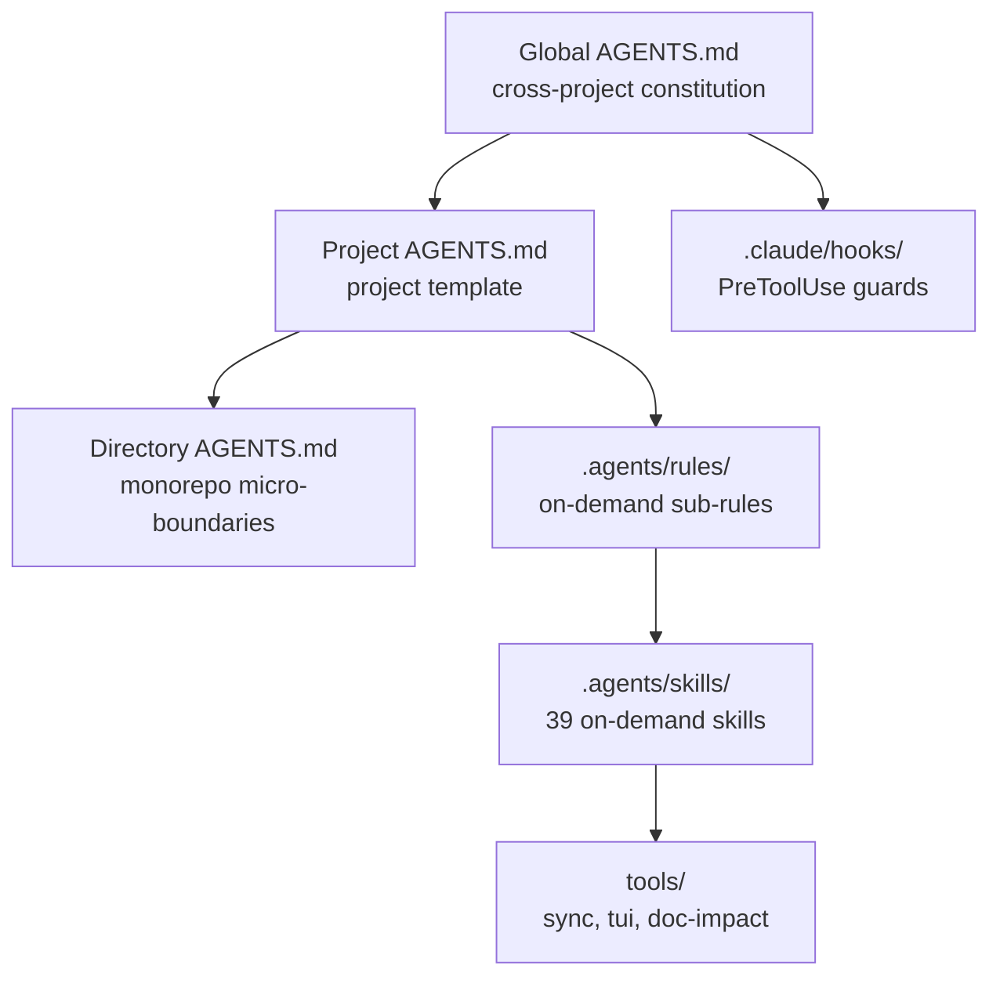

# Agent Harness

> **Language / 語言**: [English](README.md) | [簡體中文](README.zh.md) | **繁體中文**

> **可複用的 AI 程式設計規範範本、自有的驗證閘門、Claude Code 鉤子、迴圈／圖譜編排，以及多工具部署指令碼**

> **⚡ 30 秒上手**：`git clone https://github.com/xusofty-cyber/agent-harness.git && cd agent-harness && ./run-pipeline.sh --all -y`
> 詳見[快速開始](#快速開始)。對術語不熟悉？請查閱 [Glossary](docs/glossary.md)。

本倉庫提供全域、專案與目錄級規則範本、Claude Code PreToolUse 鉤子、技能檔案，以及 Windows/Linux/macOS 部署指令碼。各工具的規則載入方式與鉤子行為各不相同。鉤子屬於用戶端機制，不是作業系統或伺服器端的安全邊界。

> **定位（v0.3.0）**：本倉庫是一個設有閘門的 harness，而不只是一組設定＋技能散佈包。核心是一個自有的、僅用標準函式庫的驗證閘門（`gate/pass-gate.py`）：機器可讀的功能清單、WIP=1、需附證據的 `passing`、三層終止檢查，以及五維度的乾淨狀態檢查。它不包含任何 agent 執行期：Comet 只是可選的轉接器，不是 harness 本身。迴圈／圖譜編排僅隨 `standard`／`full` 設定檔提供（D58）；`minimal` 設定檔僅提供閘門本身。

## 前置要求

- **Linux/macOS**：`bash`、`git`、`python3`（大多數系統已預裝）
- **Windows**：PowerShell 5.1+、`git`
- **可選**：`node`（用於 Claude Code 鉤子）、`cargo`（用於 ai-memory）

---

## 架構



## 核心特性

1. **三層 AGENTS.md 漸進式揭露架構**：
   - **全域層（[`Global AGENTS.md`](templates/agents/Global%20AGENTS.zh-tw.md)）**：跨專案工程憲法，涵蓋去廢話的溝通閘門、最小實作指引、Git 授權規則與上下文工作流程指引。
   - **專案層（[`Project AGENTS.md`](templates/agents/Project%20AGENTS.zh-tw.md)）**：可調整的專案範本，涵蓋 CLI 命令、技術棧、架構邊界與按需規則參照。
   - **目錄層（[`Directory AGENTS.md`](templates/agents/Directory%20AGENTS.zh-tw.md)）**：Monorepo 套件或隔離子模組的微邊界補丁（In/Out Scope、依賴邊界、針對性的快速測試與大檔案安全）。
   - **模組化子規則（[`.agents/rules/`](.agents/rules/)）**：按需漸進式規則，包括 `token-discipline.md`、`engineering-spec.md`、`security-boundary.md` 與 `git-workflow.md`。

2. **Claude Code 用戶端鉤子（[`.claude/settings.json`](.claude/settings.json) + [`.claude/hooks/`](.claude/hooks/)）**：
   - 僅針對 Claude Code 中相符的工具呼叫執行；不是作業系統層級的防護；
   - 部分命令模式會被硬性阻擋，其他情況則發出非阻擋式警告；
   - 正則檢查無法涵蓋所有命令形式，也無法取代伺服器端分支保護。

3. **39 個可複用技能目錄（[`.agents/skills/`](.agents/skills/)）**：
   - **Comet 整合指引**：檢查已安裝版本與專案配置；此技能不實作 Comet 的狀態機或階段守衛；
   - **活文件與工程文件**：`living-documentation`（四層文件模型：specs/architecture/reference/guides、基於 frontmatter 的程式碼—文件雙向追溯、L0/L1/L2 影響維護）與 `engineering-docs`（15 個雙語階段閘門範本，涵蓋 31 種研發文件類型，確保跨 agent 的一致性）；
   - **規格驅動開發（SDD）**：完整的 12 個技能 `openspec` 套件（提案、套用變更、驗證、同步規格、歸檔、探索）；
   - **測試驅動開發（TDD）**：源自 superpowers 的工作流程技能（紅綠循環、系統性根本原因除錯、實體驗證證據閘門、git worktree）；
   - **實作與檢索指引**：`ponytail`（最小解法階梯）與 `codegraph`（可選的 CodeGraph 整合指引；CLI/MCP 設定是獨立步驟）；
   - **輸出與溝通指引**：`rtk`（可選的 Rust Token Killer CLI 指引；命令重寫鉤子需要設定）與 `caveman`（精簡回應 Skill）；
   - **決策前審查與共享記憶**：`option-review`（隔離的五維度候選方案審查矩陣）與 `cross-tool-memory`（專案範圍的長期記憶導航輔助）；
   - **專業文件處理**：`docx`（Word 格式設定與操作）與 `pdf`（結構化擷取與分析）。注意：`docx` 隨附完整的 OOXML 驗證工具鏈（約 1.3 MB，多為 XSD schema），是本倉庫最大的技能——它預設不再部署；傳入 `--include-heavy-skills` / `-IncludeHeavySkills` 才會一併部署它（以及 `brainstorming`，它隨附本地協同伺服器 `scripts/server.cjs`）。先前已部署的副本會留在原地；該旗標只影響新的副本。
   - **技能使用與觸發指南**：所有 39 個技能的觸發模式（自動／顯式／混合）、分類與專案記憶設定，詳見 [`Skills Usage Guide.md`](docs/guides/Skills%20Usage%20Guide.zh-tw.md)（[English](docs/guides/Skills%20Usage%20Guide.md) | [簡體中文](docs/guides/Skills%20Usage%20Guide.zh.md)）。部署設定檔（Phase 4，D58；成員關係的唯一事實來源是 `skills-profiles.json`）：預設僅部署 15 個技能（`--profile minimal`：10 個閘門核心＋5 個 openspec 核心）加上閘門本身（沒有 `gate/graph.py`，沒有迴圈層）；`--profile standard` 部署 20 個技能加上閘門＋編排（graph＋loop）；`--profile full` 預設部署 37 個技能加上閘門＋編排，或傳入 `--include-heavy-skills` 時部署全部 39 個。以 `minimal` 重新部署較舊的 minimal 專案會移除其 graph/loop 檔案（會先備份）；若要保留它們，請使用 `--profile standard`。

4. **一鍵部署、互動精靈與統一流水線（`deploy-agents` 與 `run-pipeline`）**：
   - **互動式逐步終端精靈**：不帶參數執行指令碼（或傳入 `--interactive` / `-Interactive`）會啟動引導式 TUI 精靈（方向鍵移動、空白鍵切換、Enter 確認），用於選擇範本語言（`en`、`zh`、`zh-tw`）、部署範圍（`project`、`global`、`both`）、目標專案路徑，以及多選 agent 橋接檔案（Claude、Copilot、Cursor、Gemini、Windsurf、Cline、Roo、Qwen、Kiro、Continue、Trae、CodeBuddy、WorkBuddy）加上可選的工作流程，避免 CLI 操作失誤；
   - **統一作業系統流水線執行器**（[`run-pipeline.sh`](run-pipeline.sh) 與 [`run-pipeline.ps1`](run-pipeline.ps1)）：以 4 個循序階段編排整個 agent 生命週期（部署規則與橋接 → 設定 AI 記憶 → 同步外部技能 → 活文件影響閘門），同時支援互動精靈模式與無人值守（`--all -y` / `-All -Yes`）模式；
   - PowerShell 自動化（[`deploy-agents.ps1`](deploy-agents.ps1)），具備非管理員權限穿透用的自動目錄 Junction，以及 Bash 自動化（[`deploy-agents.sh`](deploy-agents.sh)）；
   - 專案指令碼會在缺失時建立 `AGENTS.md`、Claude Code 與 Copilot 橋接，以及 Claude Code 鉤子；實際範圍請見支援矩陣；
   - `--global` 會設定 Claude Code、Antigravity、Codex 與 DeepSeek Harness（dsh）的全域規則檔案；`--global --update` 會備份被取代的檔案；
   - `--update` 會快轉更新此範本倉庫並同步檔案。它會在取代前備份受管的目標規則／技能。`skills-lock.json` 是來源／完整性中繼資料；指令碼不會依鎖定的雜湊下載技能。Ponytail 與 Caveman 會作為 Skill 檔案複製。CodeGraph 與 RTK 的設定是可選的；部署指令碼會針對安裝、agent 接線與專案初始化提供互動式提示。
   - 專案部署後，指令碼會偵測可選的 CodeGraph/RTK CLI，並在安裝與 agent／專案配置之前分別詢問。預設為否。非互動式執行會跳過安裝並印出後續命令。

5. **可選的跨工具專案記憶（`ai-memory`）**：
   - 所選的後端是本地優先，不需 LLM、embedding 提供者或 API 金鑰即可執行；它不會由一般的部署指令碼安裝或啟動；
   - 擷取是專案選擇加入制，透過被忽略的本地 `.ai-memory.toml`，以及以 allowlist 模式安裝的上游鉤子；
   - 專用的設定輔助工具會透過上游合併式 CLI 設定 Claude Code、Codex 與 Antigravity CLI；Antigravity 2.0 與 IDE 則透過同一個全域配置接受僅 MCP 的設定。ChatGPT 網頁版在免費的本地設定中使用人工中介的 Markdown 交接。

### 支援範圍

| 工具 | 本倉庫提供的配置 | 強制執行 | 狀態 |
|---|---|---|---|
| Claude Code | `CLAUDE.md` 橋接、`.claude/skills/` 連結、`.claude/settings.json` 鉤子 | 強制執行（鉤子） | 由指令碼設定；鉤子僅在 Claude Code 用戶端中執行 |
| Antigravity 2.0 / CLI / IDE 與擴充套件 | 專案規則／技能；`--global` 寫入 `~/.gemini/AGENTS.md` 外加 `GEMINI.md` 相容性指針 | 強制執行（鉤子） | 目前的介面會同時載入兩個全域名稱；較舊的 IDE 版本可以跟隨指針。CLI 專用規則仍維持獨立。專案會部署 Antigravity 規則轉接器（`.agents/rules/agent-harness.md`，觸發條件：always_on），指向 `AGENTS.md`，以及一組閘門鉤子（`.agents/hooks.json`：PreToolUse/Stop/SessionStart/PostToolUse），將 Antigravity 酬載轉譯為 Claude 閘門鉤子。建置環境中未驗證過實際的 Antigravity CLI/IDE 執行（沒有 `agy` 二進位檔）；協定層級測試通過（`tests/antigravity-hooks.test.mjs`） |
| Codex | 全域 `$CODEX_HOME/AGENTS.md`（預設 `~/.codex/AGENTS.md`）、專案 `AGENTS.md` 與 `.agents/skills/` | 僅配置 | `-Global` 會初始化 Codex 全域檔案；`-Global -Update` 會備份並取代作用中的全域指示 |
| WorkBuddy | `.workbuddy/rules/agent-harness.md` 規則橋接 + `.workbuddy/settings.json` 閘門鉤子 | 閘門鉤子 | 鉤子把假定的 Claude 形酬載原樣交給 Claude 閘門指令碼（PreToolUse/Stop/SessionStart/PostToolUse）；鉤子格式與設定檔位置均未對照官方文件（本輪未抓取）或真機核實，協定層級測試通過；本倉庫發到 `.workbuddy/settings.json`，請在已安裝版本上確認 |
| DeepSeek Harness (dsh) | 透過 `--global` 設定全域 `${DSH_HOME:-~/.dsh}/AGENTS.md`；專案 `AGENTS.md` 原生讀取；技能透過 `.agents/skills/` | 閘門外掛（需手動啟用，dsh 真機未驗證） | 沒有專案橋接檔案（`AGENTS.md` 會被原生讀取）；部署指令碼另裝 Cordis 閘門外掛（`.dsh/agent-harness-gate.mjs`，TypeScript 原始碼為 `.dsh/agent-harness-gate.ts`）與 `.dsh/cordis.patch.yml` 掛載行——啟用需手動，且 dsh 外掛 API 未在官方文件／真機上核實，不要把它當作已驗證的強制執行 |
| ai-memory | Claude Code、Codex CLI 與 Antigravity CLI 的可選 MCP/hooks；Antigravity 2.0 與 IDE 僅 MCP 設定 | 僅配置 | 需每個專案明確選擇加入；Codex 桌面版必須對照已安裝版本檢查；ChatGPT 網頁版使用人工交接 |
| GitHub Copilot | `.github/copilot-instructions.md` 橋接 | 僅配置 | 由指令碼設定；行為取決於 Copilot 版本／模式 |
| Zed | `AGENTS.md` | 僅檔案 | 僅提供可複用檔案；指令碼不建立 Zed 專屬設定 |
| Pi / OpenCode | 沒有專用進入點或指令碼驗證 | 僅檔案 | 未適配；不意味著會自動載入 |

使用部署期間的 `-Initialize` / `--initialize`，以本地可驗證的專案事實建立指引，以及一份未知事項檢查清單。加上 `-DirectoryPath` / `--directory` 並指定現有模組路徑，也可以產生該模組的目錄級指引。指令碼僅推斷本地 Git 中繼資料、manifest、lockfile 與 CI 檔案所支援的事實。對於 `package.json`，偵測到的指令碼與常見的框架／儲存依賴會標註為待審查的建議，而非已驗證的事實。使用者或作用中的程式設計 agent 必須確認用途、所有權、模組責任與邊界。現有的 `AGENTS.md` 檔案會被保留；審查副本會寫為 `AGENTS.generated.md`。執行 `-Check` / `--check` 來找出未解決的項目。

### 目前狀態（v0.3.0）——在依賴閘門之前請先閱讀

- **強制執行取決於宿主。** Claude Code 鉤子會在用戶端中強制執行閘門（見上表）。Antigravity 鉤子與 dsh 閘門外掛雖已部署，但其真機強制執行均未驗證（見上表）。在其他所有宿主上，閘門是一套紀律外加一道人工命令：請自行執行 `python3 gate/pass-gate.py verify` 與 `python3 gate/pass-gate.py check-clean`。與宿主無關的後備措施是 CI，它會重新執行每個 `passing` 項目的驗證命令（`tests/repo_checks.py` §3k）。已知繞過方式詳見 [`gate/README.md`](gate/README.md)，包括透過 Bash 直接編輯，以及純文字的成本帳本。
- **基準聲明，如實陳述。** 預先註冊的 B1 回合（t1–t8 × bare/pack/gate × 3 回合＝72 次執行）72/72 通過，每個組別皆為 0 次錯誤完成，因此依其預先註冊的規則，結果為 NO DISCRIMINATION。本版本不聲稱閘門能減少錯誤完成；唯一的攔截證據是 Phase 1 的 dogfood（一個被鉤子與 CI 攔下的植入式假通過）。
- **B2 更難的基準，已預先註冊但尚未執行。** `eval/results/b2-preregistration-2026-10-29.md` 註冊了 t9–t12（多檔案＋文件同步、隱藏邊界案例、斷點續跑、含決策記錄優先的模糊需求）× bare/pack/gate × 3 回合＝36 次執行，沿用 B1 的決策規則：只有當 gate 比 bare 少至少 2 次錯誤完成時才算 DISCRIMINATION，而全零組別同樣意味著 NO DISCRIMINATION，而非成功。目前尚無 B2 執行；任務與其參照解答已驗證（設定＋解答＋驗收），但尚未量測任何組別。
- **與宿主無關的第二道閘門（pre-push＋CI 範本）。** `templates/pre-push-gate/`（鉤子範本、檢查器、可選安裝器）與 `templates/ci-gate-check.yml` 為沒有執行期鉤子的專案提供一道不依賴任何宿主的閘門：檢查器會重新執行每個 `passing` 項目的驗證，並拒絕過時的證據，呼應 §3k。安裝方式有兩種：執行安裝器（明確選擇加入），或使用部署指令碼，部署指令碼目前預設會安裝這三個檔案（以 `--no-prepush-gate` / `-NoPrepushGate` 停用；保留 `--prepush-gate` / `-PrepushGate` 以相容），並遵循慣常的「已存在則跳過／更新時備份」規則。指南中所述的限制：pre-push 鉤子檢查的是工作樹，而不是被推送的提交，而 `git push --no-verify` 可以繞過它——請搭配 CI 範本與伺服器端分支保護。
- **評估器僅供建議（D28）。** `eval/rubric.md` 評分六個維度，但 `evaluate.py --gate` 永遠拒絕，最終由人類決定。評分表的五輪校準使用的是記錄下來的階段結果，而非即時的第二位評判。
- **翻譯。** EN 與 ZH 是事實來源。ZH-TW 各列依 `docs/internal/i18n-status.md` 為 stale/frozen；在下一次發行前請從 EN 重新生成，不要逐句手工同步。
- **Windows。** CI 會對 PowerShell 指令碼執行 PSScriptAnalyzer；CI 中的部署冒煙測試執行的是 Bash 指令碼。PowerShell 部署路徑是經審查驗證的，未在 CI 的 Windows 上實際執行驗證。

---

## 目錄結構

```text
agent-harness/
├── .agents/
│   ├── rules/                       # 模組化子規則（按需載入）
│   │   ├── engineering-spec.md      # SDD 規格先行、TDD 驗證閘門
│   │   ├── git-workflow.md          # Git 授權模型、受保護分支隔離
│   │   ├── security-boundary.md     # 8 項高風險操作保護矩陣
│   │   └── token-discipline.md      # 讀取／取得／表述閘門、日誌截斷
│   └── skills/                      # 39 個原生工程技能（Comet、OpenSpec、Superpowers…）
├── .claude/
│   ├── settings.json                # Claude Code 鉤子設定（五類鉤子事件全接線）
│   └── hooks/                       # 鉤子指令碼（Node.js，讀取 stdin JSON）
│       ├── guard.mjs                # Bash 工具守衛（exit 2 硬阻斷）
│       ├── guard-write.mjs          # Write/Edit 工具守衛（警告）
│       ├── guard-feature-list.mjs   # 拒絕直接 Write/Edit 功能清單
│       ├── stop-gate.mjs            # 有 in_progress 項目時阻擋停止
│       ├── session-start.mjs        # 依閘門狀態印出工作階段恢復資訊
│       └── post-tool-use.mjs        # 附加成本帳本遙測
├── gate/                            # 自有驗證閘門
│   ├── pass-gate.py                 # 功能清單狀態機＋驗證＋ clean-state 檢查
│   ├── graph.py                     # 圖執行器（僅 standard/full 設定檔）
│   ├── feature_list.schema.json     # 狀態、轉換、WIP=1、證據規則
│   └── init.template.sh             # 為專案搭建閘門＋一次冒煙執行
├── tools/
│   ├── loop.py                      # Goal Loop／Maker-Checker 執行器（僅 standard/full 設定檔）
│   ├── sync-skills.py               # 外部技能同步與上游更新檢查
│   └── doc-impact.py                # 活文件影響分析與品質閘門
├── eval/                            # 自建基準（t1–t8）＋評分表（僅供建議）
├── templates/
│   └── agents/                      # 標準規則範本（Global／Project／Directory × en／zh／zh-tw）
├── run-pipeline.ps1                 # Windows PowerShell 統一流水線執行器
├── run-pipeline.sh                  # Linux／macOS Bash 統一流水線執行器
├── deploy-agents.ps1                # Windows PowerShell 一鍵部署與更新指令碼
├── deploy-agents.sh                 # Linux／macOS Bash 一鍵部署與更新指令碼
├── setup-ai-memory.ps1              # 單一選擇加入專案／客戶端的 ai-memory 顯式設定
├── setup-ai-memory.sh               # Linux／macOS／WSL 設定輔助工具
├── tools/tui.py                     # 終端 UI 單選／多選元件庫
├── .ai-memory.toml.example          # 可安全複製的本地選擇加入標記範例
├── skills-lock.json                 # 技能來源與部分完整性中繼資料
├── README.md                        # 專案總覽（English 預設）
└── README.zh.md                     # 專案中文概覽
```

---

## 快速開始

### 1. 統一流水線一鍵執行（建議）

透過統一的作業系統流水線執行器，依序執行全部生命週期階段（部署規則與橋接 → 設定 AI 記憶 → 同步外部技能 → 活文件影響檢查）：

- **Linux / macOS（Bash）**：
  ```bash
  # 互動精靈（逐步 TUI 選擇）：
  ./run-pipeline.sh
  # 無人值守完整流水線：
  ./run-pipeline.sh --all -y
  ```

- **Windows（PowerShell）**：
  ```powershell
  # 互動精靈（逐步 TUI 選擇）：
  .\run-pipeline.ps1
  # 無人值守完整流水線：
  .\run-pipeline.ps1 -All -Yes
  ```

### 2. 獨立部署與互動精靈

- **互動精靈（零參數執行）**：
  ```bash
  # Linux / macOS:
  ./deploy-agents.sh
  # Windows:
  .\deploy-agents.ps1
  ```
  *啟動逐步 TUI 精靈：單選語言、單選範圍、輸入路徑、多選 agent 橋接與可選工作流程。*

- **Windows CLI（PowerShell）**：
  ```powershell
  # 部署到目標專案（預設為英文，或選擇 -Language zh / zh-tw）
  .\deploy-agents.ps1 -ProjectPath "D:\Projects\my-project" -Global -Language en -Initialize -DirectoryPath "packages/core"
  .\deploy-agents.ps1 -ProjectPath "D:\Projects\my-project" -Check -DirectoryPath "packages/core"
  ```

- **Linux / macOS CLI（Bash）**：
  ```bash
  chmod +x ./deploy-agents.sh
  # 部署並選擇語言（預設為英文，或 --lang zh / zh-tw）
  ./deploy-agents.sh /path/to/my-project --global --lang en --initialize --directory packages/core
  ./deploy-agents.sh /path/to/my-project --check --directory packages/core
  ```

### 3. 可選：啟用本地跨工具記憶（ai-memory）

本倉庫支援透過 [ai-memory](https://github.com/akitaonrails/ai-memory)，讓多個 agent 無縫共享架構決策與工作階段上下文（本地優先，零 API 金鑰，零 embedding 成本）。詳細的部署工作流程：

#### Step 1: 安裝前置 CLI 並準備環境
- **透過 Rust Cargo**：
  ```bash
  cargo install ai-memory
  ```
- **或透過 GitHub Releases（預先建置的二進位檔）**：
  - **Linux / macOS**：
    ```bash
    mkdir -p ~/.local/bin
    curl -fsSL https://github.com/akitaonrails/ai-memory/releases/latest/download/ai-memory-linux-x86_64.tar.gz | tar -xz -C ~/.local/bin/
    chmod +x ~/.local/bin/ai-memory
    export PATH="$HOME/.local/bin:$PATH"
    ```
  - **Windows**：
    從 [Releases](https://github.com/akitaonrails/ai-memory/releases) 下載發行壓縮檔（`ai-memory-windows-x86_64.zip`），解壓縮後將其目錄加入系統 `PATH`。
- 💡 **疑難排解：Windows 終端機 PATH 重新整理**
  若你在 Antigravity IDE / VS Code 執行期間修改了 `PATH`，作用中的終端機工作階段不會繼承變更。在 PowerShell 中，直接從登錄檔重新整理 PATH，無需重新啟動 IDE：
  ```powershell
  $env:Path = [System.Environment]::GetEnvironmentVariable("Path","Machine") + ";" + [System.Environment]::GetEnvironmentVariable("Path","User")
  ```

#### Step 2: 初始化本地專案選擇加入標記（.ai-memory.toml）
ai-memory 強制執行安全的預設拒絕政策，在擷取任何倉庫之前需要明確的選擇加入標記（此檔案已被 `.gitignore` 忽略，因此絕不會被意外提交）：
- **Windows PowerShell**：
  ```powershell
  Copy-Item .ai-memory.toml.example .ai-memory.toml
  (Get-Content .ai-memory.toml) `
      -replace 'replace-with-workspace-name', 'default' `
      -replace 'replace-with-project-name', 'agent-harness' |
      Set-Content .ai-memory.toml
  ```
- **Linux / macOS（Bash）**：
  ```bash
  cp .ai-memory.toml.example .ai-memory.toml
  sed -i 's/replace-with-workspace-name/default/g; s/replace-with-project-name/agent-harness/g' .ai-memory.toml
  ```

#### Step 3: 執行用戶端設定輔助工具
執行設定指令碼以註冊 MCP 端點與受管的技能指示（支援 `antigravity-ide`、`antigravity-cli`、`claude-code`、`codex`）：
- **Windows**：
  ```powershell
  .\setup-ai-memory.ps1 -Agent antigravity-ide
  ```
- **Linux / macOS**：
  ```bash
  chmod +x ./setup-ai-memory.sh
  ./setup-ai-memory.sh antigravity-ide
  ```
- 🔍 **輸出指引**：
  - `✓ no-op ... (already up to date)`：表示**冪等保護**；現有的目標檔案已是最新，無需重寫。
  - `Configured <agent>. No server, container, API key, or LLM provider was installed or started.`：宣告性地確認用戶端配置已完成，符合零常駐程式／零計費的保證。

#### Step 4: 啟動本地記憶引擎
- **Antigravity IDE（透過 HTTP MCP）**：
  > ⚠️ `ai-memory serve` 預設使用 `stdio` 傳輸模式，不會綁定網路連接埠。若要為 Antigravity IDE 提供服務，**必須以 `--transport http` 啟動它**：
  - **終端機前景執行**：
    ```bash
    ai-memory serve --transport http
    ```
    當終端機印出 `bind=127.0.0.1:49374` 時，伺服器已就緒，IDE 可以透過 MCP 查詢並儲存專案記憶。
  - **Linux 背景常駐程式（nohup / systemd）**：
    使用 `nohup ai-memory serve --transport http > ~/.local/share/ai-memory/serve.log 2>&1 &`，或建立使用者層級的 `systemd --user` 服務。
  - **Docker 容器**：
    ```bash
    # 容器內資料路徑固定為 /data；綁定 127.0.0.1 以確保本地安全
    docker run -d --name ai-memory \
      --restart unless-stopped \
      -p 127.0.0.1:49374:49374 \
      -v "${HOME}/env/ai-memory-data:/data" \
      docker.io/akitaonrails/ai-memory:latest
    ```
- **Claude Code / Codex CLI**：
  原生生命週期鉤子會自動擷取工作階段，或使用 `ai-memory run <harness>` 啟動受管的工作流。

### 4. 執行線上更新

當上游規則或技能更新時，直接在倉庫中執行：
```powershell
# Windows
.\deploy-agents.ps1 -ProjectPath "." -Update

# Linux / macOS
./deploy-agents.sh . --update
```

---

## 文件索引

- 📖 **部署與配置**：
  - [繁體中文](docs/guides/Multi-Tool%20Deployment%20and%20Configuration%20Guide.zh-tw.md) | [English](docs/guides/Multi-Tool%20Deployment%20and%20Configuration%20Guide.md) | [簡體中文](docs/guides/Multi-Tool%20Deployment%20and%20Configuration%20Guide.zh.md)
- 📖 **實戰用法與技能全景**：
  - [繁體中文](docs/guides/Tools%20Practical%20Usage%20and%20Skills%20Panorama%20Guide.zh-tw.md) | [English](docs/guides/Tools%20Practical%20Usage%20and%20Skills%20Panorama%20Guide.md) | [簡體中文](docs/guides/Tools%20Practical%20Usage%20and%20Skills%20Panorama%20Guide.zh.md)
- 📜 **三層規則架構**：
  - **全域規則**：[`Global AGENTS.zh-tw.md`](templates/agents/Global%20AGENTS.zh-tw.md)（繁體中文）| [`English`](templates/agents/Global%20AGENTS.en.md) | [`簡體中文`](templates/agents/Global%20AGENTS.md)
  - **專案規則**：[`Project AGENTS.zh-tw.md`](templates/agents/Project%20AGENTS.zh-tw.md)（繁體中文）| [`English`](templates/agents/Project%20AGENTS.en.md) | [`簡體中文`](templates/agents/Project%20AGENTS.md)
  - **目錄規則**：[`Directory AGENTS.zh-tw.md`](templates/agents/Directory%20AGENTS.zh-tw.md)（繁體中文）| [`English`](templates/agents/Directory%20AGENTS.en.md) | [`簡體中文`](templates/agents/Directory%20AGENTS.md)

---

## 授權條款

本專案採用 MIT 授權。內嵌的第三方技能屬於其各自的原作者與授權條款。
