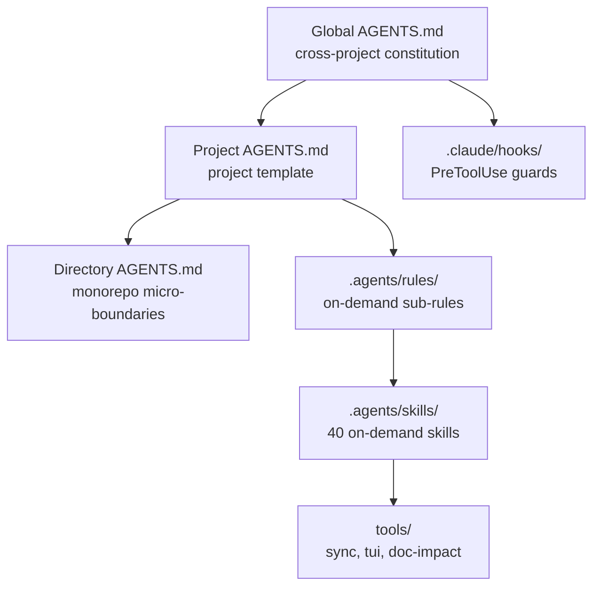

# Agent Harness

> **Language / 语言**: [English](README.md) | **简体中文** | [繁體中文](README.zh-tw.md)

> **可复用的 AI 编程规范模板、Claude Code 安全钩子与多工具部署脚本**

> **⚡ 30 秒上手**：`git clone https://github.com/xusofty-cyber/agent-harness.git && cd agent-harness && ./run-pipeline.sh`
> 详情见 [快速开始](#快速开始)。术语不懂？查 [术语表](docs/glossary.md)。

本项目提供全局、项目和目录级规范模板、Claude Code PreToolUse 钩子、技能文件，以及 Windows/Linux/macOS 部署脚本。各工具的规则加载方式和钩子能力不同；请以支持矩阵和部署脚本实际行为为准。钩子属于客户端机制，不是操作系统或服务端安全边界。

> **定位（v0.3.0）**：本仓库是一套带门禁的 harness，而不只是配置 + 技能分发包。核心是自有的纯标准库验证门禁（`gate/pass-gate.py`）：机器可读功能清单、WIP=1、passing 必须有证据、三层终止校验、五维 clean-state 检查。不包含任何 Agent 运行时；Comet 只是可选适配器，不是本仓库本身。循环 / 图编排只随 `standard` / `full` 档发货（D58），`minimal` 档只有门禁本身。

## 前置要求

- **Linux/macOS**：`bash`、`git`、`python3`（大多数系统已预装）
- **Windows**：PowerShell 5.1+、`git`
- **可选**：`node`（用于 Claude Code 钩子）、`cargo`（用于 ai-memory）

---

## 架构



## 核心特性

1. **三级 AGENTS.md 渐进式披露架构**：
   - **全局级（[`Global AGENTS.md`](templates/agents/Global%20AGENTS.md)）**：跨项目通用工程宪法，涵盖沟通、实现、上下文与 Git 授权边界。
   - **项目级（[`Project AGENTS.md`](templates/agents/Project%20AGENTS.md)）**：可裁剪的项目工程模板，提供 CLI 命令、技术栈、架构边界和按需规则索引。
   - **目录级（[`Directory AGENTS.md`](templates/agents/Directory%20AGENTS.md)）**：Monorepo / 独立子模块的微型边界补丁（In/Out Scope、依赖隔离与极速测试）。
   - **细粒度子规则库（[`.agents/rules/`](.agents/rules/)）**：按需动态查阅，涵盖 `token-discipline.md`、`engineering-spec.md`、`security-boundary.md` 与 `git-workflow.md`。

2. **Claude Code 客户端钩子（[`.claude/settings.json`](.claude/settings.json) + [`.claude/hooks/`](.claude/hooks/)）**：
   - 仅针对 Claude Code 中匹配的工具调用运行，不是操作系统级防护；
   - 使用 Node.js 守卫脚本通过 stdin JSON 读取工具输入（Claude Code 官方协议），以 `exit 2` / `permissionDecision: deny` 实现可靠阻断；
   - 永久硬拦截（`exit 2`）：受保护分支（`develop`/`master`/`main`/`release*`/`staging`）直改提交、`git push --force`、删除受保护远端分支、受保护分支 rebase；
   - 部分命令会硬拒绝，其他情况只是非阻断警告；正则检查不能覆盖所有命令形式，也不能替代 Git 服务端分支保护。

3. **40 个可复用技能目录（[`.agents/skills/`](.agents/skills/)）**：
   - **Comet 集成说明**：引导检查已安装版本和项目配置；此技能本身不实现 Comet 状态机或阶段守卫。
   - **活体文档与工程文档规范**：`living-documentation`（六阶文档体系：specs/architecture/reference/guides，Frontmatter 代码双向追溯关联，L0/L1/L2 变更门禁与文档演进）与 `engineering-docs`（31 种研发文档类型，15 个中英双语门禁模板，确保各 Agent 阶段输出格式一致）。
   - **规范驱动开发（SDD）**：`openspec` 全套 12 个技能（提案、变更应用、验证、主文档同步、归档）。
   - **测试驱动开发（TDD）**：源自 superpowers 的工作流技能（TDD 红绿循环、系统性排障、完工验证证据门、工作区隔离）。
   - **实现与检索指导**：`ponytail`（最小实现决策阶梯）与 `codegraph`（CodeGraph 可选集成指引；CLI/MCP 需单独安装配置）。
   - **输出与表达指导**：`rtk`（Rust Token Killer 可选 CLI 指引；需配置命令重写 Hook）与 `caveman`（简明表达 Skill）。
   - **事前决策评审与共享记忆**：`option-review`（5 维度多候选方案事前独立评审与决策矩阵）与 `cross-tool-memory`（跨工具项目长期记忆导航与经验检索）。
   - **专业文档处理**：`docx`（Word 专业排版）、`pdf`（结构化抽取与分析）。注：`docx` 自带完整 OOXML 校验工具链（约 1.3 MB），是仓库内最大的 skill，默认不再部署；需要时加 `--include-heavy-skills` / `-IncludeHeavySkills`（同时包含带本地服务 `scripts/server.cjs` 的 `brainstorming`）；已部署的旧副本不受影响，该选项只影响本次新复制；
   - **技能使用与触发时机指南**：各 skill 的触发机制（自动/显式/混合）、分类速查与项目记忆使用说明详见 [`Skills Usage Guide.zh.md`](docs/guides/Skills%20Usage%20Guide.zh.md)（[English](docs/guides/Skills%20Usage%20Guide.md) | [繁體中文](docs/guides/Skills%20Usage%20Guide.zh-tw.md)）。部署分层（Phase 4，D58；成员以 `skills-profiles.json` 为唯一事实源）：默认只部署 15 个技能（`--profile minimal`：10 个门禁核心 + 5 个 openspec 核心）加门禁本身（不含 `gate/graph.py` 与循环层）；`--profile standard` 部署 20 个技能加门禁 + 编排（graph + loop）；`--profile full` 默认部署 38 个技能加门禁 + 编排，加 `--include-heavy-skills` 才到全部 40 个。此前以 minimal 部署过、已带有 graph/loop 的项目，重新以 minimal 部署后这些文件会被移除（部署脚本会先备份）；如需保留请改用 `--profile standard`。
   - **Agent 正确触发与常见问题排查指南 (FAQ)**：如何精准唤醒特定技能、避免角色扮演式脑补、正确配置 AI 记忆与状态机排障详见 [`Agent Triggering and FAQ Guide.zh.md`](docs/guides/Agent%20Triggering%20and%20FAQ%20Guide.zh.md)。

4. **一键部署、交互向导与统一流水线（`deploy-agents` & `run-pipeline`）**：
   - **交互式终端逐步选择向导**：执行脚本时不带任何参数（或显式指定 `--interactive` / `-Interactive`）将自动拉起向导（上下方向键选择、空格键切选、Enter 确认），引导完成规则模板语言（`en`, `zh`, `zh-tw`）、部署范围（`project`, `global`, `both`）、目标项目路径、13 种 Agent 桥接文件多选（Claude, Copilot, Cursor, Gemini, Windsurf, Cline, Roo, Qwen, Kiro, Continue, Trae, CodeBuddy, WorkBuddy）以及可选工作流开关，彻底杜绝命令行参数遗漏与拼写错误；
   - **跨平台统一工程流水线执行器**（[`run-pipeline.sh`](run-pipeline.sh) 与 [`run-pipeline.ps1`](run-pipeline.ps1)）：一键按序贯通 4 大工程生命周期阶段（规则分发与桥接部署 → AI 跨工具长效记忆配置 → 外部技能同步与哈希锁定 → 活体文档溯源分析与质检门禁），同时支持交互式自选与全自动无人值守（`--all -y` / `-All -Yes`）模式；
   - Windows PowerShell（[`deploy-agents.ps1`](deploy-agents.ps1)，内置 UTF-8 兼容与 Junction 权限免提权穿透）与 Linux/macOS Bash（[`deploy-agents.sh`](deploy-agents.sh)）；
   - 项目脚本创建 `AGENTS.md`（若不存在）、Claude Code 与 Copilot 桥接，并部署 Claude Code Hook；其他工具的具体加载行为以支持矩阵为准；
   - `--global` 配置 Claude Code、Antigravity、Codex 与 DeepSeek Harness (dsh) 全局规则；`--global --update` 覆盖前备份；
   - `--update` 通过 fast-forward 更新本模板仓库并同步文件。覆盖工具管理的目标规则/技能前会创建备份；`skills-lock.json` 是来源/完整性元数据，不代表脚本按锁定哈希下载技能。Ponytail/Caveman 以 Skill 文件随项目复制；CodeGraph/RTK 的 CLI、Agent 接线与项目初始化是可选步骤；部署脚本会在交互模式下征询是否执行。
   - 项目部署后会检测可选的 CodeGraph/RTK CLI，并逐项询问是否安装、是否配置 Agent/项目；默认拒绝。非交互执行会跳过安装并输出后续命令。

5. **可选跨工具项目记忆（`ai-memory`）**：
   - 选择本地优先方案；不配置 LLM、embedding provider 或 API Key 也可使用；普通部署脚本不会安装或启动服务；
   - 自动采集需通过被 Git 忽略的 `.ai-memory.toml` 显式加入项目，并以 allowlist 模式安装上游 hooks；
   - 专用辅助脚本通过上游合并式 CLI 配置 Claude Code、Codex 和 Antigravity CLI；Antigravity 2.0 与 IDE 通过共用全局配置接入 MCP。免费本地方案下 ChatGPT 网页版采用人工 Markdown 交接。

### 支持范围

| 工具 | 本仓库提供的配置/接线 | 执行档 | 状态 |
|---|---|---|---|
| Claude Code | `CLAUDE.md` 桥接、`.claude/skills/` 链接、`.claude/settings.json` Hook | 强制（钩子） | 脚本配置；Hook 仅在 Claude Code 客户端运行 |
| Antigravity 2.0 / CLI / IDE 与扩展 | 项目规则/技能目录；`--global` 写入 `~/.gemini/AGENTS.md` 和 `GEMINI.md` 兼容指针 | 钩子强制 | 当前表面支持两个全局文件名；较早 IDE 可跟随指针读取规范文件；CLI 专属规则另行配置。项目另部署 Antigravity 规则适配文件（`.agents/rules/agent-harness.md`，trigger: always_on），指向 `AGENTS.md`，以及门禁钩子集（`.agents/hooks.json`：PreToolUse/Stop/SessionStart/PostToolUse），把 Antigravity 负载翻译成 Claude 门禁钩子。构建环境无 `agy` 二进制，Antigravity CLI/IDE 真机运行未验证；协议级测试通过（`tests/antigravity-hooks.test.mjs`） |
| Codex | 全局 `$CODEX_HOME/AGENTS.md`（默认 `~/.codex/AGENTS.md`）、项目 `AGENTS.md` 与 `.agents/skills/` | 配置 | `-Global` 初始化 Codex 全局文件；`-Global -Update` 备份后覆盖当前生效的全局规则 |
| WorkBuddy | `.workbuddy/rules/agent-harness.md` 规则桥接 | 配置 | 仅桥接文件；本层不为 WorkBuddy 安装钩子；未在每个 WorkBuddy 版本上验证加载，请在已装版本上确认 |
| DeepSeek Harness (dsh) | 全局 `${DSH_HOME:-~/.dsh}/AGENTS.md`（经 `--global` 部署）；项目 `AGENTS.md` 原生读取；技能走 `.agents/skills/` | 配置 | 不创建项目级桥接文件（`AGENTS.md` 原生读取）；经 `cordis.patch.yml` 的 MCP 接入与门禁强制不在本桥接层内 |
| ai-memory | Claude Code、Codex CLI、Antigravity CLI 的可选 MCP/hooks；Antigravity 2.0 与 IDE 提供 MCP-only 设置 | 配置 | 项目显式选择加入；Codex 桌面版按安装版本核实；ChatGPT 网页版人工交接 |
| GitHub Copilot | `.github/copilot-instructions.md` 桥接 | 配置 | 脚本配置；具体行为依 Copilot 版本/模式 |
| Zed | `AGENTS.md` 文件 | 仅文件 | 提供可复用文件；脚本不创建 Zed 专属配置 |
| Pi / OpenCode | 未提供专用入口或脚本验证 | 仅文件 | 未适配；不能据此推断自动加载 |

---

## 目录结构

```text
agent-harness/
├── .agents/
│   ├── rules/                       # 细粒度工程子规则库（按需渐进式加载）
│   │   ├── engineering-spec.md      # SDD 规范先行、TDD 验证证据门
│   │   ├── git-workflow.md          # Git 授权模型、受保护分支强隔离、提交规范
│   │   ├── security-boundary.md     # 八大高风险操作防呆矩阵、凭证零泄露
│   │   └── token-discipline.md      # 读拿说三道闸门、上下文防漏与日志截断
│   └── skills/                      # 40 个原生工程技能库（Comet, OpenSpec, Superpowers...）
├── .claude/
│   ├── settings.json                # Claude Code 钩子配置（五类钩子事件全接线）
│   └── hooks/                       # 钩子脚本（Node.js，读取 stdin JSON）
│       ├── guard.mjs                # Bash 工具守卫（exit 2 硬阻断）
│       ├── guard-write.mjs          # Write/Edit 工具守卫（高危预警）
│       ├── guard-feature-list.mjs   # 拒绝直接 Write/Edit 功能清单
│       ├── stop-gate.mjs            # 有 in_progress 项时拦截停止
│       ├── session-start.mjs        # 从门禁状态打印会话恢复信息
│       └── post-tool-use.mjs        # 追加成本账本遥测
├── gate/                            # 自有验证门禁
│   ├── pass-gate.py                 # 功能清单状态机 + 验证 + clean-state 检查
│   ├── graph.py                     # 图执行器（仅 standard/full 档）
│   ├── feature_list.schema.json     # 状态、迁移、WIP=1、证据规则
│   └── init.template.sh             # 为项目搭建门禁 + 一次冒烟
├── tools/
│   ├── loop.py                      # Goal Loop / Maker-Checker 运行器（仅 standard/full 档）
│   ├── sync-skills.py               # 外部依赖技能库同步与上游差异比对工具
│   └── doc-impact.py                # 活体文档影响分析与质检门禁工具
├── eval/                            # 自建基准（t1–t8）+ 评分表（仅咨询级）
├── templates/
│   └── agents/                      # 规范规则模板（全局/项目级/目录级 × en/zh/zh-tw）
├── run-pipeline.ps1                 # Windows PowerShell 统一流水线执行脚本
├── run-pipeline.sh                  # Linux / macOS Bash 统一流水线执行脚本
├── deploy-agents.ps1                # Windows 一键部署与在线更新自动化脚本
├── deploy-agents.sh                 # Linux / macOS 一键部署与在线更新自动化脚本
├── setup-ai-memory.ps1              # 单项目/单客户端显式安装辅助脚本
├── setup-ai-memory.sh               # Linux / macOS / WSL 显式安装辅助脚本
├── tools/tui.py                     # 终端交互式单选/多选组件库
├── .ai-memory.toml.example          # 本地显式加入标记示例
├── skills-lock.json                 # 技能来源及部分文件完整性元数据
├── README.md                        # 项目总览（English）
└── README.zh.md                     # 项目总览（中文）
```

首次部署时可用 `-Initialize` / `--initialize` 生成带项目事实和待确认清单的规则；使用 `-DirectoryPath` / `--directory` 指定一个已存在的模块目录，同时生成目录级规则。脚本只自动填写可从本地 Git、清单/锁文件和 CI 配置核实的信息；检测到 `package.json` 时还会把存在的 scripts 命令、常见框架/存储依赖列为“建议确认”，不会当成已验证的事实。业务定位、维护者、模块职责和边界交由用户或当前编码 Agent 确认。已有 `AGENTS.md` 不会被覆盖，改为生成 `AGENTS.generated.md` 供审阅。完成后使用 `-Check` / `--check` 检查待确认项。

### 当前状态（v0.3.0）——依赖门禁前请先读

- **强制力取决于宿主。** Claude Code 钩子在客户端强制执行门禁（见上表）。其他宿主上，门禁是一套纪律加手动命令：自己跑 `python3 gate/pass-gate.py verify` 和 `python3 gate/pass-gate.py check-clean`。与宿主无关的兜底是 CI，它会重跑每个 `passing` 项的验证命令（`tests/repo_checks.py` §3k）。已知绕过方式见 [`gate/README.md`](gate/README.md)，包括经 Bash 直接改写、明文成本账本。
- **基准结论如实表述。** 预注册 B1 轮（t1–t8 × bare/pack/gate × 3 轮 = 72 轮）72/72 通过、每臂 0 错误完成，按事前规则判为 NO DISCRIMINATION。本版本不宣称门禁降低了错误完成率；唯一的拦截证据是 Phase 1 dogfood（植入的假通过被钩子和 CI 抓住）。
- **B2 更难基准，已预注册、尚未跑。** `eval/results/b2-preregistration-2026-10-29.md` 预注册了 t9–t12（多文件 + 文档同步、隐藏边界用例、断点续跑、歧义需求先写决策记录）× bare/pack/gate × 3 轮 = 36 轮，沿用 B1 的判定规则：只有 gate 比 bare 少至少 2 次错误完成才算 DISCRIMINATION，各臂仍为 0 还是 NO DISCRIMINATION，不是成功。B2 目前没有任何轮次记录；任务与参考解已验证（setup + solution + acceptance 走通），但还没有任何一臂被实测。
- **宿主无关的第二道门（pre-push + CI 模板）。** `templates/pre-push-gate/`（钩子模板、检查器、opt-in 安装器）与 `templates/ci-gate-check.yml` 给没有运行时钩子的项目一道不依赖任何宿主的门：检查器重跑每个 `passing` 项的验证并拒绝过期证据，与 §3k 对齐。安装只能显式 opt-in：要么自己跑安装器，要么给部署脚本传 `--prepush-gate`（PowerShell 里是 `-PrepushGate`），由部署脚本按跳过已有 / 更新先备份的规矩装齐三件文件。该选项默认关闭；是否要变成默认值仍是开放问题。边界见指南：pre-push 钩子检查的是工作区，不是被推送的提交；`git push --no-verify` 可绕过——要配 CI 模板和服务端分支保护一起用。
- **评分表仅咨询级（D28）。** `eval/rubric.md` 六维打分，但 `evaluate.py --gate` 恒拒绝，最终由人决定。5 轮校准用的是历史阶段结果，不是活人二审。
- **翻译。** EN 与 ZH 为事实源。ZH-TW 行按 `docs/internal/i18n-status.md` 为 stale / 冻结状态，下个发布前从 EN 重新生成，不要逐句手工同步。
- **Windows。** CI 对 PowerShell 脚本跑 PSScriptAnalyzer；CI 的部署冒烟跑的是 Bash 脚本。PowerShell 部署路径为评审验证，未在 CI 的 Windows 真机上执行验证。

---

## 快速开始

### 1. 统一工程流水线一键执行（推荐）

通过操作系统对应的原生流水线脚本，按序贯通全部工程阶段（规则与桥接部署 → AI 记忆配置 → 外部技能同步 → 活体文档质检）：

- **Linux / macOS 环境 (Bash)**:
  ```bash
  # 交互式向导模式（单选语言、多选阶段、选择执行模式）：
  ./run-pipeline.sh
  # 无人值守一键全量流水线：
  ./run-pipeline.sh --all -y
  ```

- **Windows 环境 (PowerShell)**:
  ```powershell
  # 交互式向导模式：
  .\run-pipeline.ps1
  # 无人值守一键全量流水线：
  .\run-pipeline.ps1 -All -Yes
  ```

### 2. 独立部署规范与交互式向导

- **交互式向导（零参数启动）**:
  ```bash
  # Linux / macOS:
  ./deploy-agents.sh
  # Windows:
  .\deploy-agents.ps1
  ```
  *自动拉起终端逐步选择向导：单选语言、单选部署范围、输入项目路径、多选 Agent 工具桥接与可选工作流。*

- **Windows 命令行 (PowerShell)**:
  ```powershell
  # 部署到指定项目（默认 en，或指定 -Language zh / zh-tw）
  .\deploy-agents.ps1 -ProjectPath "D:\Projects\my-project" -Global -Language zh -Initialize -DirectoryPath "packages/core"
  .\deploy-agents.ps1 -ProjectPath "D:\Projects\my-project" -Check -DirectoryPath "packages/core"
  ```

- **Linux / macOS 命令行 (Bash)**:
  ```bash
  chmod +x ./deploy-agents.sh
  # 支持多语言模板切换（默认 en，或 --lang zh / zh-tw）
  ./deploy-agents.sh /path/to/my-project --global --lang zh --initialize --directory packages/core
  ./deploy-agents.sh /path/to/my-project --check --directory packages/core
  ```

### 3. 可选：启用本地跨工具记忆（ai-memory）

本仓库支持通过 [ai-memory](https://github.com/akitaonrails/ai-memory) 实现多 Agent 间无缝共享架构事实与会话断点（本地优先，零 API Key，零 Embedding 成本）。详细部署流程如下：

#### Step 1: 安装前置 CLI 并就绪环境
- **通过 Rust Cargo 安装**：
  ```bash
  cargo install ai-memory
  ```
- **或通过 GitHub Releases 下载原生二进制**：
  - **Linux / macOS**:
    ```bash
    mkdir -p ~/.local/bin
    curl -fsSL https://github.com/akitaonrails/ai-memory/releases/latest/download/ai-memory-linux-x86_64.tar.gz | tar -xz -C ~/.local/bin/
    chmod +x ~/.local/bin/ai-memory
    export PATH="$HOME/.local/bin:$PATH"
    ```
  - **Windows**:
    访问 [Releases](https://github.com/akitaonrails/ai-memory/releases) 下载 `ai-memory-windows-x86_64.zip`，解压后将其所在目录加入系统环境变量 `PATH`。
- 💡 **避坑提醒（Windows IDE 内置终端 PATH 刷新）**：
  若在运行中的 Antigravity IDE / VS Code 中修改了 PATH，已开终端无法感知新变量。在 PowerShell 窗口执行以下命令可直接从注册表刷新 PATH，无需重启 IDE：
  ```powershell
  $env:Path = [System.Environment]::GetEnvironmentVariable("Path","Machine") + ";" + [System.Environment]::GetEnvironmentVariable("Path","User")
  ```

#### Step 2: 初始化项目本地声明标记（.ai-memory.toml）
ai-memory 采用安全优先的 Fail-closed 门禁，必须显式声明才激活项目采集（该文件已被 `.gitignore` 忽略，安全不会被误提交）：
- **Windows PowerShell**:
  ```powershell
  Copy-Item .ai-memory.toml.example .ai-memory.toml
  (Get-Content .ai-memory.toml) `
      -replace 'replace-with-workspace-name', 'default' `
      -replace 'replace-with-project-name', 'agent-harness' |
      Set-Content .ai-memory.toml
  ```
- **Linux / macOS (Bash)**:
  ```bash
  cp .ai-memory.toml.example .ai-memory.toml
  sed -i 's/replace-with-workspace-name/default/g; s/replace-with-project-name/agent-harness/g' .ai-memory.toml
  ```

#### Step 3: 执行单客户端配置脚本
运行辅助脚本自动向客户端挂载 MCP 节点与专属技能指令（支持 `antigravity-ide`, `antigravity-cli`, `claude-code`, `codex`）：
- **Windows**:
  ```powershell
  .\setup-ai-memory.ps1 -Agent antigravity-ide
  ```
- **Linux / macOS**:
  ```bash
  chmod +x ./setup-ai-memory.sh
  ./setup-ai-memory.sh antigravity-ide
  ```
- 🔍 **控制台输出解读**：
  - `✓ no-op ... (already up to date)`：代表**幂等性保护**生效，目标配置已经是最新版本，自动跳过重复写入；
  - `Configured <agent>. No server, container, API key, or LLM provider was installed or started.`：声明性成功结语，表明配置已完成，且坚守零常驻、零容器、零 API 扣费的安全底线。

#### Step 4: 启动本地记忆引擎服务
- **面向 Antigravity IDE（通过 HTTP MCP 接入）**：
  > ⚠️ `ai-memory serve` 默认采用 `stdio` 管道模式，不会开启网络端口。要为 IDE 提供服务，**必须使用 `--transport http` 启动**：
  - **终端直接运行**：
    ```bash
    ai-memory serve --transport http
    ```
    终端输出 `bind=127.0.0.1:49374` 即代表服务就绪，IDE 的 MCP 即可正常检索与存储记忆。
  - **Linux 后台常驻 / 开机自启**：
    可使用 `nohup ai-memory serve --transport http > ~/.local/share/ai-memory/serve.log 2>&1 &` 或配置为 `systemd --user` 服务。
  - **Docker 容器化运行（隔离环境）**：
    ```bash
    # 容器内部数据目录固定为 /data，绑定 127.0.0.1 保持环回安全
    docker run -d --name ai-memory \
      --restart unless-stopped \
      -p 127.0.0.1:49374:49374 \
      -v "${HOME}/env/ai-memory-data:/data" \
      docker.io/akitaonrails/ai-memory:latest
    ```
- **面向 Claude Code / Codex CLI**：
  可通过原生 hooks 自动捕获，或使用 `ai-memory run <harness>` 进行受管托管启动。

### 4. 在线更新规范与技能库

当上游规则或 GitHub Skills 发生更新时，直接在项目根目录运行：
```powershell
# Windows
.\deploy-agents.ps1 -ProjectPath "." -Update

# Linux / macOS
./deploy-agents.sh . --update
```

---

## 文档索引

- 📖 **部署与配置指南**：
  - [简体中文](docs/guides/Multi-Tool%20Deployment%20and%20Configuration%20Guide.zh.md) | [English](docs/guides/Multi-Tool%20Deployment%20and%20Configuration%20Guide.md) | [繁體中文](docs/guides/Multi-Tool%20Deployment%20and%20Configuration%20Guide.zh-tw.md)
- 📖 **实战使用与技能全景**：
  - [简体中文](docs/guides/Tools%20Practical%20Usage%20and%20Skills%20Panorama%20Guide.zh.md) | [English](docs/guides/Tools%20Practical%20Usage%20and%20Skills%20Panorama%20Guide.md) | [繁體中文](docs/guides/Tools%20Practical%20Usage%20and%20Skills%20Panorama%20Guide.zh-tw.md)
- 📜 **三级规则架构**：
  - **全局宪法**：[`Global AGENTS.md`](templates/agents/Global%20AGENTS.md)（简体中文）| [`English`](templates/agents/Global%20AGENTS.en.md) | [`繁體中文`](templates/agents/Global%20AGENTS.zh-tw.md)
  - **项目规范**：[`Project AGENTS.md`](templates/agents/Project%20AGENTS.md)（简体中文）| [`English`](templates/agents/Project%20AGENTS.en.md) | [`繁體中文`](templates/agents/Project%20AGENTS.zh-tw.md)
  - **目录规则**：[`Directory AGENTS.md`](templates/agents/Directory%20AGENTS.md)（简体中文）| [`English`](templates/agents/Directory%20AGENTS.en.md) | [`繁體中文`](templates/agents/Directory%20AGENTS.zh-tw.md)

---

## 许可证

本项目遵循 MIT 开源许可协议。各内置第三方技能遵循其各自的原生开源协议。
